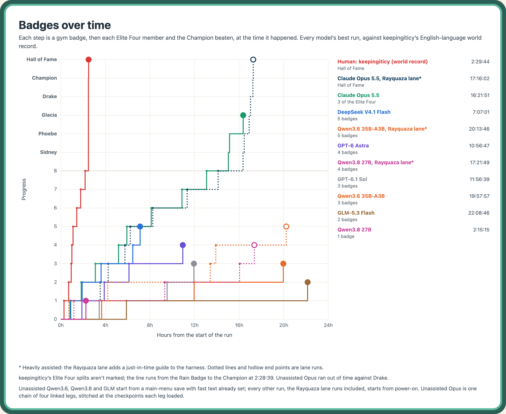
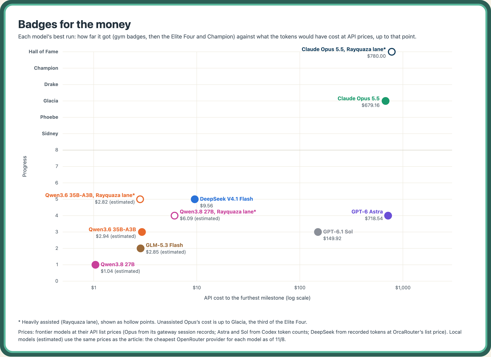

# PokeBench

How far can a local vision-language model get in Pokémon Emerald when it is given a specialized harness?

- **Agent:** TypeScript on [pi](https://github.com/badlogic/pi-mono). It plays through an OpenAI-compatible model endpoint you configure (a local llama.cpp or vLLM server, or a gateway that reports each model's limits); there is no built-in one. See [Connect a model](docs/connect-a-model.md) for local servers, gateways, Hermes, Claude and Codex.
- **Environment:** a native mGBA build on Apple Silicon. It drives the [continual-harness](https://github.com/sethkarten/continual-harness) game server (the PokéAgent Challenge starter kit), vendored unmodified at a pinned commit.
- **Observability:** a viewer shows the live game, button presses, thinking traces and tool calls.

You supply the ROM, Pokémon Emerald (USA, Europe), SHA-1 `f3ae088181bf583e55daf962a92bb46f4f1d07b7`. It is never committed. Keep it outside the repo, for example at `~/.roms/pokemon-emerald.gba`, and set `POKEBENCH_ROM` to that path in the gitignored `.env`.

## Setup

> **Supported platforms**
>
> | Platform | Status |
> |---|---|
> | macOS on Apple Silicon (arm64) | Tested. Everything here runs on it. |
> | Linux | Untested. A trial on a GPU box is in progress; `scripts/build-mgba.sh` is macOS-only today. |
> | Windows | Not supported. |

### Prerequisites

| Tool | Why | macOS (Homebrew) | Linux (apt) |
|---|---|---|---|
| [just](https://github.com/casey/just) | runs every command here | `just` | `just` |
| Node.js 26 or newer | agent and viewer; older Node exits 0 without running them | `node` | from nodejs.org or nvm |
| pnpm 10.32.1 | Node packages, pinned in `package.json`; Node 25+ no longer bundles corepack | `npm install -g corepack`, then `corepack enable pnpm` | `npm install -g corepack`, then `corepack enable pnpm` |
| [uv](https://docs.astral.sh/uv/) and Python 3.11 | Python environment | `uv`, then `uv python install 3.11` | uv installer, then `uv python install 3.11` |
| cmake and a C toolchain | building mGBA | `cmake`; `xcode-select --install` | `cmake build-essential` |
| FFmpeg and libpng, with headers | building mGBA | `ffmpeg libpng` | `libavcodec-dev libavformat-dev libavfilter-dev libavutil-dev libswscale-dev libswresample-dev libpng-dev pkg-config` |

### Steps

1. Clone with the vendored game server:

   ```bash
   git clone --recurse-submodules <repository-url> pokebench
   cd pokebench
   ```

   In an existing clone, run `git submodule update --init env/vendor/continual-harness`.
2. Copy the settings template and check the machine:

   ```bash
   cp .env.example .env
   just doctor
   ```

   `just doctor` is a read-only preflight. It prints PASS, FAIL or SKIP for each prerequisite above, the vendored server, the mGBA build, the ROM's SHA-1 and the model endpoint if one is set, with the command that fixes each miss. It exits non-zero only when a check fails. `just doctor core` and `just doctor game` stop after that tier.
3. Install both stacks and enable the git hooks: `just setup`.
4. Build mGBA and its Python binding: `just build-mgba`. `just lint` needs it too, because mypy type-checks the binding's imports.
5. Climb the three tiers below. Each adds one thing you supply.

**Tier 1, no ROM: the code and its tests.**

```bash
just lint
just test
```

`just test` runs every Vitest and pytest suite once, coverage-instrumented, under guards that fail any test doing disk, process or network I/O.

**Tier 2, the game: your ROM.** Set `POKEBENCH_ROM` in `.env`, then:

```bash
just verify-rom
just smoke
```

`just smoke` boots the real game server on 127.0.0.1, presses A and reads back state, a screenshot and milestones.

**Tier 3, a model: an endpoint.** Set `POKEBENCH_MODEL` and either `POKEBENCH_GATEWAY_URL` or `POKEBENCH_ENDPOINT_FILE` in `.env` ([Connect a model](docs/connect-a-model.md)), then:

```bash
just smoke-llm
just run-agent
```

`just smoke-llm` runs one agent loop against the game; `just run-agent` starts an ordinary run. Watch it with `just view` on `http://127.0.0.1:8790/`.

## Cost and hardware

| | |
|---|---|
| Longest finished run | Run 67d7 (Claude Opus, boot to Hall of Fame): 17h 16m wall clock, 4,124 turns. |
| Its tokens | About 659M: 574.2M cache read, 75.1M cache write, 8.0M input, 1.64M output (from the model gateway's session record; the run's events log 0 on subscription lanes). |
| Its price | $780.55 at API list price. It ran on a Claude Max plan, so it was not billed per token. |
| Recording | The optional video recorder (`just record`) writes about 8 GB per day of play. |
| Local models | A GPU that serves each model with a 64K-token context. |

## Results





Each chart shows every model's best run, read from its own recording. Times are wall clock from the start of the run. Unassisted Opus is one chain of four linked legs, stitched at the checkpoints each leg loaded. Rayquaza lane runs are heavily assisted and drawn dotted or hollow. Frontier models are priced at API list price; local models are estimates at the cheapest OpenRouter provider for each model as of 11/8.

| Run | Model | Start | Result |
|---|---|---|---|
| 67d7, assisted (Rayquaza knowledge lane) | Claude Opus (`claude-opus-5-5`) | boot | Hall of Fame in one run: 4,124 turns, 17h 16m |
| 37ca | DeepSeek V4.1 Flash, hosted | boot | 5 badges in 24 h |
| 80c8 | DeepSeek V4.1 Flash, hosted | boot | Stone Badge in 55m 13s (turn 223) |
| ee2a | DeepSeek V4.1 Flash, hosted | Fortree checkpoint | Feather Badge at turn 86 |

These runs, with their harness commits, presets, budgets and evidence, are in the [results ledger](docs/results.md).

## Working on PokeBench

See [CONTRIBUTING.md](CONTRIBUTING.md) for submitting a run or a reproduction and for the lint, test and review gates, and [SECURITY.md](SECURITY.md) for what binds where and how to report a vulnerability.

`CLAUDE.md`, `AGENTS.md` and `.claude/` are the operator's working files for the coding agents (Claude Code, Codex) that build PokeBench: project rules, workflow and skills. `docs/worklogs/` holds the history of that work.
