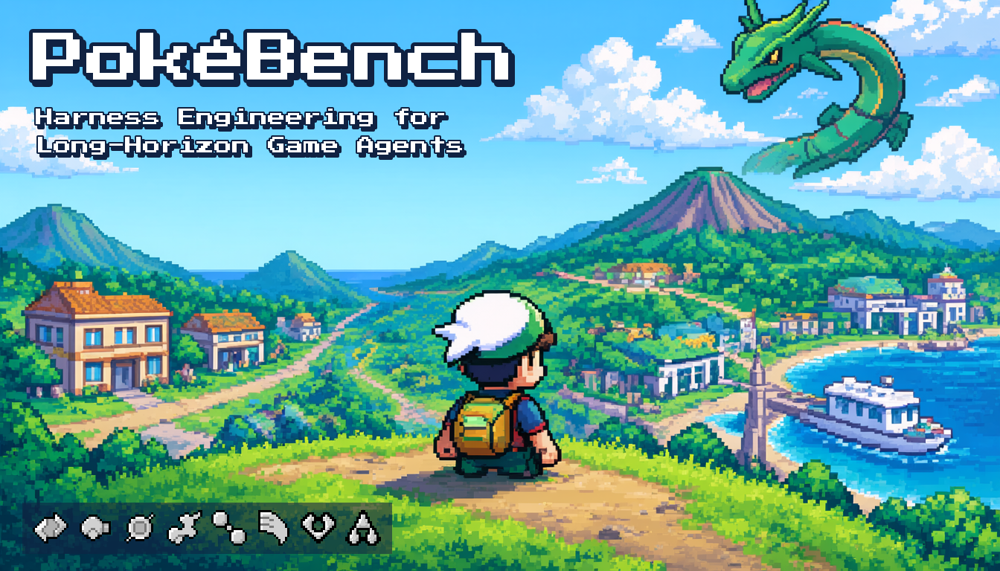
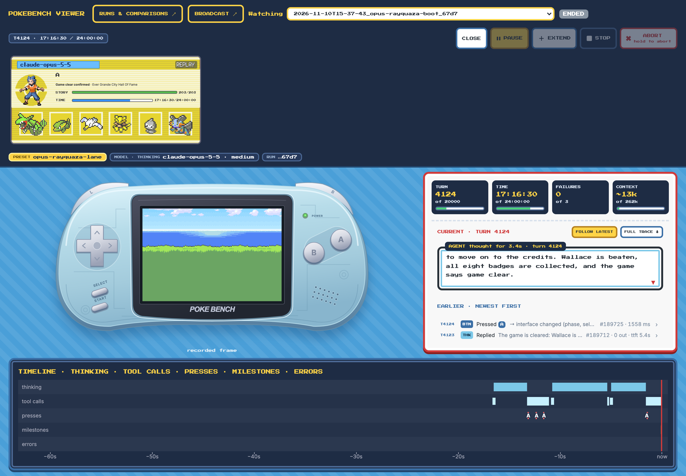
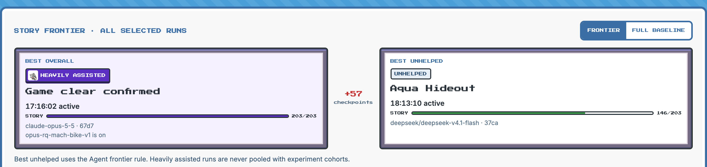
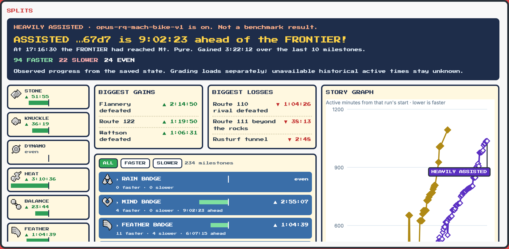

# PokéBench

How far can a vision-language model get in Pokémon Emerald when the harness around it does the right work? PokéBench is a benchmark harness for finding out, with local and frontier models playing the real game from power-on.

## Results

Claude Opus 5.5 beat the game in one run from power-on, in 4,124 turns and 17 hours 16 minutes. It caught Rayquaza at Sky Pillar with the Master Ball, lost to Glacia on its first Elite Four attempt, restocked at the League mart and won the retry. That run used the Rayquaza lane, which adds a just-in-time game guide to the harness, so it counts as heavily assisted.

| Model | Setup | Furthest | Time |
|---|---|---|---|
| Claude Opus 5.5 | Rayquaza lane (heavily assisted) | Hall of Fame | 17:16:30 |
| DeepSeek V4.1 Flash | Unhelped | 5 badges, then Team Aqua's hideout | 5th badge at 7:07:01 |
| Qwen3.6 35B-A3B (local) | Rayquaza lane (heavily assisted) | 5 badges | 5th badge at 20:13:45 |
| Qwen3.6 35B-A3B (local) | Unhelped | 3 badges | 3rd badge at 19:57:57 |
| keepingiticy (human world record) | | 8 badges | 8th badge at 2:11:01 |

Times are wall-clock hours from the start of the run. The Qwen runs start from a main-menu save with fast text; the rest start from power-on.

## The viewer

Every run is recorded, and the viewer replays it with the game screen, the model's thinking, its tool calls and a timeline of button presses and milestones.



The frontier shows the best run overall next to the best unhelped run, and the splits page races any run against the frontier milestone by milestone.





## How it works

Each turn the harness reads the game's memory, turns it into a text readout the model can act on (where it is, the exits, the people, the battle state), and gives the model tools such as `navigate_to_target` and `battle_action`. The model decides, the harness carries out the buttons and reports what happened, and the next turn starts.


- **Agent:** TypeScript on [pi](https://github.com/badlogic/pi-mono), talking to any OpenAI-compatible endpoint.
- **Environment:** a native mGBA build driving the [continual-harness](https://github.com/sethkarten/continual-harness) game server, the starter kit for the [PokéAgent Challenge](https://pokeagent.github.io/) (NeurIPS 2025), vendored unmodified at a pinned commit.
- **Feature switches:** every harness behavior sits behind a switch whose off state is the old behavior, so changes can be A/B tested. Explainers for each switch live in `docs/explainers/`.

## Quick start

You need an Apple Silicon Mac with Homebrew (`cmake`, `ffmpeg`, `libpng`), Node 26 with pnpm, uv with Python 3.11, and [just](https://github.com/casey/just).

1. Clone with the game-server submodule.

   ```bash
   git clone --recursive https://github.com/AOrobator/pokebench.git
   cd pokebench
   ```

2. Bring your own ROM: Pokémon Emerald (USA, Europe), SHA-1 `f3ae088181bf583e55daf962a92bb46f4f1d07b7`. No ROM is included. Set its path in a gitignored `.env`.

   ```bash
   echo "POKEBENCH_ROM=$HOME/.roms/pokemon-emerald.gba" > .env
   ```

3. Install, build the emulator and check the setup.

   ```bash
   just setup
   just build-mgba
   just verify-rom
   just smoke
   ```

4. Point it at a model and start a run. [Connect a model](docs/connect-a-model.md) covers llama.cpp, vLLM and gateways.

   ```bash
   export POKEBENCH_ENDPOINT_FILE="$PWD/endpoint.json"
   export POKEBENCH_MODEL="your-model-id"
   just run-agent
   ```

   To play with the Rayquaza lane, add `POKEBENCH_PLAY_PRESET=experiments/presets/opus-rayquaza-lane.json`.

5. Watch it at http://127.0.0.1:8790.

   ```bash
   just view
   ```

## Documentation

- [Connect a model](docs/connect-a-model.md)
- [Benchmarking and grading](docs/benchmarking/)
- [The Rayquaza lane curriculum](docs/curriculum/)
- [Feature explainers](docs/explainers/)
- [Human play](docs/human-play.md)

## Citation

```bibtex
@software{orobator2026pokebench,
  author = {Orobator, Andrew},
  title  = {PokéBench: Harness Engineering for Long-Horizon Game Agents},
  year   = {2026},
  url    = {https://github.com/AOrobator/pokebench}
}
```

## Licence

The code and documentation are under the [MIT License](LICENSE). Bundled fonts keep their own licence (`packages/viewer/static/fonts/NOTICE.md`), and `env/vendor/continual-harness` has its own.

Pokémon names, game text and images belong to Nintendo, Creatures Inc. and GAME FREAK inc., and appear here for research only. This project is not affiliated with or endorsed by them.
