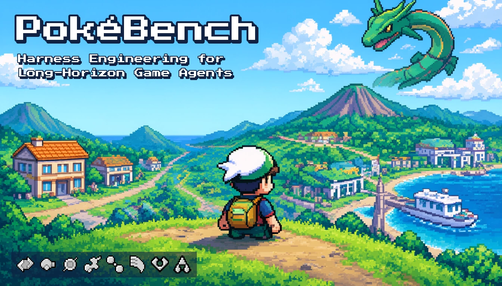
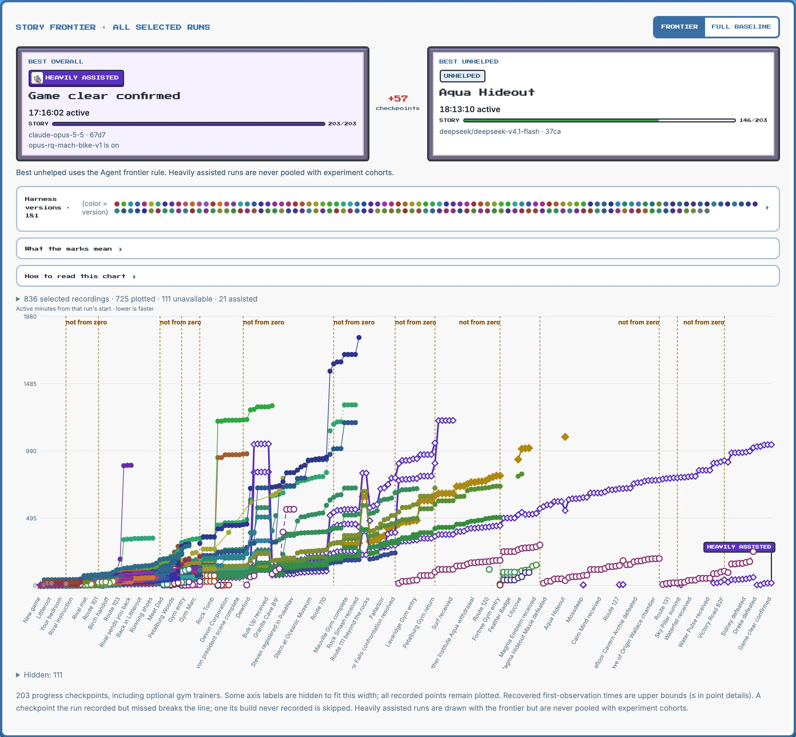
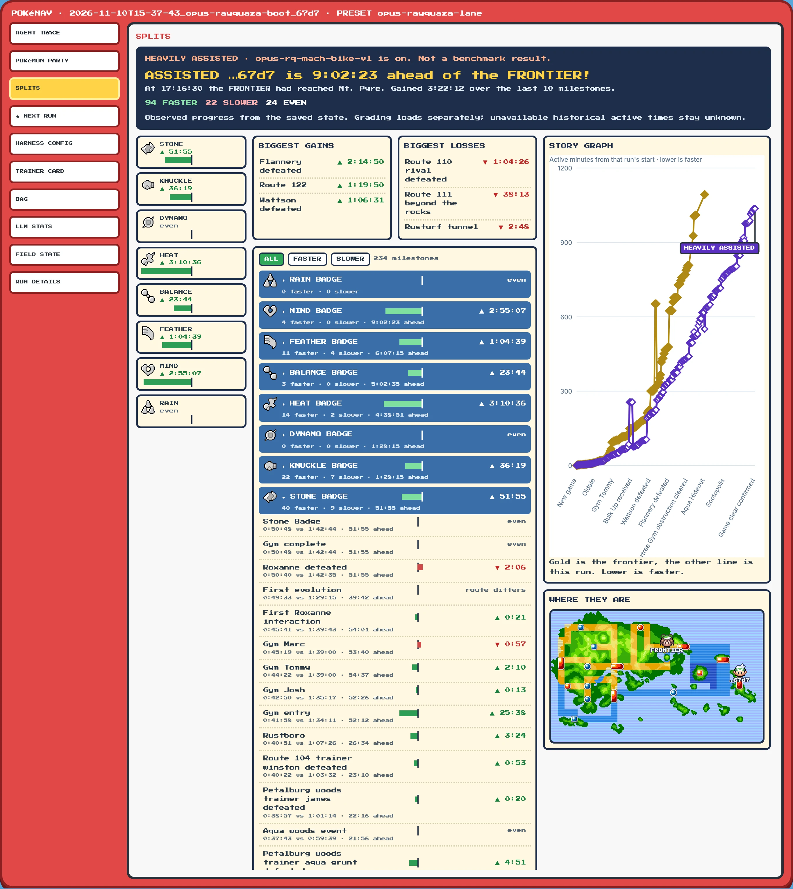
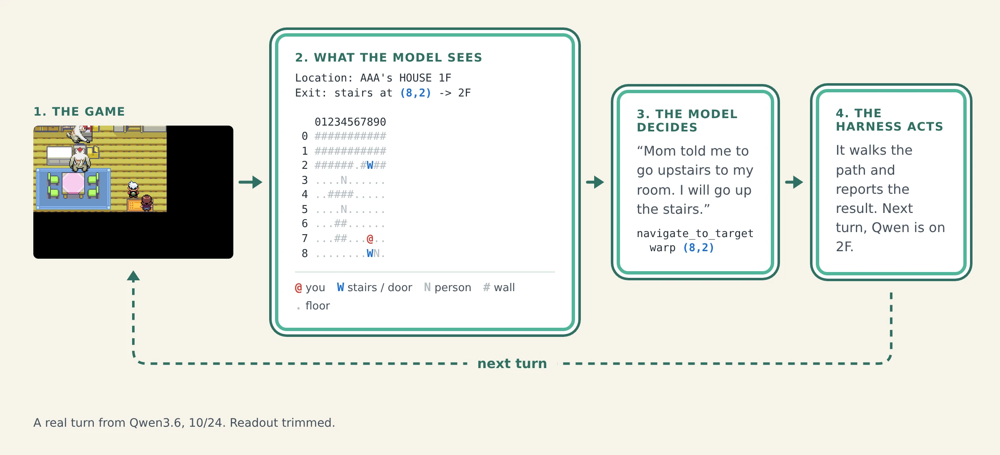

# PokéBench

How far can a vision-language model get in Pokémon Emerald when the harness around it does the right work? PokéBench is a benchmark harness for finding out, with local and frontier models playing the real game from power-on.

## Results

Claude Opus 5.5 beat the game in one run from power-on, in 4,124 turns and 17 hours 16 minutes. It caught Rayquaza at Sky Pillar with the Master Ball, lost to Glacia on its first Elite Four attempt, restocked at the League mart and won the retry. That run used the Rayquaza lane, which adds a just-in-time game guide to the harness, so it counts as heavily assisted.

| Model | Setup | Furthest | Time |
|---|---|---|---|
| Claude Opus 5.5 | Rayquaza lane (heavily assisted) | Hall of Fame | 17:16:30 |
| DeepSeek V4.1 Flash | Unhelped | 5 badges, then Team Aqua's hideout | 5th badge at 7:07:01 |
| Qwen3.6 35B-A3B (local) | Rayquaza lane (heavily assisted) | 5 badges | 5th badge at 20:13:45 |
| Qwen3.6 35B-A3B (local) | Unhelped | 3 badges | 3rd badge at 19:57:57 |
| keepingiticy (human world record) | | 8 badges | 8th badge at 2:11:01 |

Times are wall-clock hours from the start of the run. The Qwen runs start from a main-menu save with fast text; the rest start from power-on.


Each chart shows every model's best run, read from its own recording. Unassisted Opus is one chain of four linked legs, stitched at the checkpoints each leg loaded. Rayquaza lane runs are heavily assisted and drawn dotted or hollow. Frontier models are priced at API list price; local models are estimates at the cheapest OpenRouter provider for each model's recorded tokens, as of 11/11.

DeepSeek V4.1 Flash also took the Stone Badge 55m 13s after power-on (run `80c8`, turn 223), and from a Fortree City checkpoint it earned the Feather Badge at turn 86 (run `ee2a`). The [results ledger](docs/results.md) lists these runs with their harness commits, presets, budgets and evidence.

## The viewer

Every run is recorded, and the viewer replays it with the game screen, the model's thinking, its tool calls and a timeline of button presses and milestones.


The frontier page puts the best run overall beside the best unhelped one, and plots every recorded run against the story checkpoints.



The splits page races one run against the frontier, badge by badge, with the story graph and where both runs are on the map.



## How it works

Each turn the harness reads the game's memory, turns it into a text readout the model can act on (where it is, the exits, the people, the battle state), and gives the model tools such as `navigate_to_target` and `battle_action`. The model decides, the harness carries out the buttons and reports what happened, and the next turn starts.



- **Agent:** TypeScript on [pi](https://github.com/badlogic/pi-mono), talking to any OpenAI-compatible endpoint.
- **Environment:** a native mGBA build driving the [continual-harness](https://github.com/sethkarten/continual-harness) game server, the starter kit for the [PokéAgent Challenge](https://pokeagent.github.io/) (NeurIPS 2025), vendored unmodified at a pinned commit.
- **Feature switches:** every harness behavior sits behind a switch whose off state is the old behavior, so changes can be A/B tested. Explainers for each switch live in `docs/explainers/`.

## Quick start

It runs on macOS on Apple Silicon and on Linux x86_64 (tested on Ubuntu 24.04); Windows is not supported. You need [just](https://github.com/casey/just), Node 26 or newer with pnpm 10.32.1 (`npm install -g corepack`, then `corepack enable pnpm`), [uv](https://docs.astral.sh/uv/) with Python 3.11 (`uv python install 3.11`), cmake with a C toolchain, and FFmpeg and libpng with their headers.

- **macOS:** `xcode-select --install`, then `brew install just node uv cmake ffmpeg libpng`.
- **Ubuntu or Debian:** install Node from nodejs.org (the distribution's package is too old) and uv with its installer, then:

  ```bash
  sudo apt-get update
  sudo apt-get install -y just cmake build-essential pkg-config libavcodec-dev libavformat-dev libavfilter-dev libavutil-dev libswscale-dev libswresample-dev libpng-dev zlib1g-dev
  ```

1. Clone, then check out the game-server submodule.

   ```bash
   git clone https://github.com/AOrobator/pokebench.git
   cd pokebench
   git submodule update --init env/vendor/continual-harness
   ```

   Initialise only that submodule: the game server has a nested submodule with no URL, so `git clone --recursive` ends with an error.

2. Copy the settings template and check the machine. `just doctor` is read-only: it prints PASS, FAIL or SKIP for each prerequisite, with the command that fixes each miss. The model checks show SKIP until you set a model in step 5.

   ```bash
   cp .env.example .env
   just doctor
   ```

3. Install, build the emulator and run the tests. No ROM is needed yet.

   ```bash
   just setup
   just build-mgba
   just lint
   just test
   ```

4. Bring your own ROM: Pokémon Emerald (USA, Europe), SHA-1 `f3ae088181bf583e55daf962a92bb46f4f1d07b7`. No ROM is included. Set `POKEBENCH_ROM` to its path in `.env`, then boot the game.

   ```bash
   just verify-rom
   just smoke
   ```

5. Point it at a model and start a run. Set `POKEBENCH_MODEL` and either `POKEBENCH_GATEWAY_URL` or `POKEBENCH_ENDPOINT_FILE` in `.env`; [Connect a model](docs/connect-a-model.md) covers llama.cpp, vLLM and gateways.

   ```bash
   just smoke-llm
   just run-agent
   ```

   To play with the Rayquaza lane, add `POKEBENCH_PLAY_PRESET=experiments/presets/opus-rayquaza-lane.json`.

6. Watch it at http://127.0.0.1:8790.

   ```bash
   just view
   ```

## Documentation

- [Connect a model](docs/connect-a-model.md)
- [Benchmarking and grading](docs/benchmarking/)
- [The Rayquaza lane curriculum](docs/curriculum/)
- [Feature explainers](docs/explainers/)
- [Human play](docs/human-play.md)

## Citation

```bibtex
@software{orobator2026pokebench,
  author = {Orobator, Andrew},
  title  = {PokéBench: Harness Engineering for Long-Horizon Game Agents},
  year   = {2026},
  url    = {https://github.com/AOrobator/pokebench}
}
```

## Licence

The code and documentation are under the [MIT License](LICENSE). Bundled fonts keep their own licence (`packages/viewer/static/fonts/NOTICE.md`), and `env/vendor/continual-harness` has its own.

Pokémon names, game text and images belong to Nintendo, Creatures Inc. and GAME FREAK inc., and appear here for research only. This project is not affiliated with or endorsed by them.
