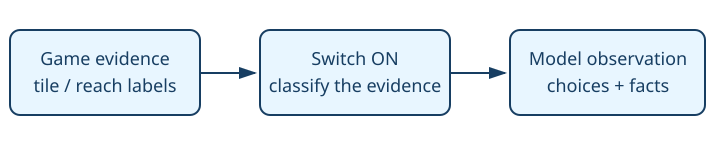

# Active warp exits

> Markdown twin of [active-warp-exits-v1.html](../active-warp-exits-v1.html), generated from the HTML by `just explainer-twins`. The HTML is the source; edit it, not this file.

A map event is only an entrance candidate when its tile supports activation.

`active-warp-exits-v1` — default OFF. Enabled only in the bundle of the two evolving recipes. Control stays OFF.

## Why

Dormant Terra Cave entries appeared in the Route 116 arrival summary at seq 29346 of run 0517. The map event exists before the entrance tile is opened.

## Evidence controls the list

Read coherent current tiles → match source warp behavior → list candidate or retain unknown activation. Remote summaries inspect ROM terrain and explicitly say on-load scripts may change it.

## Same situation, OFF and ON

| OFF | ON |
|---|---|
| Every static warp event can appear as an exit. | Ordinary terrain over a warp event is omitted from exit choices and W glyphs. Script-owned or unreadable activation remains conditional. |

## Wiring

Preset feature → registered server switch → coherent reader / formatter → tool result and recorded observation → supervisor and replay. No automatic game input.

## Game grounding and proof

IsWarpMetatileBehavior, IsArrowWarpMetatileBehavior and TryDoorWarp in field_control_avatar.c; Route116_OnLoad and AbnormalWeather_EventScript_PlaceTilesRoute116North/South.

Native archived RAM at seq 29344 and 29777, source revision 731ad5bfd6e6f265508d0efcca0ba42f9dcf5881. The tunnel arrival summary stops advertising closed Terra Cave warps; current Route 116 retains real tunnel doors. A controlled overlay of a real entrance tile proves live-open beats ROM-closed. This overlay is a test, not measured gameplay.

Limits and status

Implementation candidate on a working branch. Full gates, independent review, landing and served verification are tracked in the worklog. No gameplay benefit claim or new run launch. Existing recorded runs retain their original feature settings.

