Harness switch · observation · `adjacent-tiles-v1` · needs `live-map-v1` · off by default

# Adjacent tiles

> Markdown twin of [adjacent-tiles-v1.html](../adjacent-tiles-v1.html), generated from the HTML by `just explainer-twins`. The HTML is the source; edit it, not this file.

With the switch on, one line directly under the local map names the four tiles next to the player in words: up, down, left and right, each with its coordinates and the glyph the map draws for it. The model no longer has to count columns in a 15×15 grid to know what is in front of it.

## 1. What went wrong in the showcase run

Recorded in `2026-10-16T00-34-26_qwen36-gpu1_show`, Route 101. The player stood at (8,7) in a pocket below a row of one-way ledges (`v`, hop down only). Reading the grid, the model wrote at turn 459 that the map shows (8,6) as `.`; row 6, column 8 is `v`. At turn 447 it read (10,13) as `g` where row 13 shows `v`. It pressed UP into ledges about 40 times in turns 447–498, and again from turn 802.



*Rows 5–8, columns 5–11 of the local map recorded at turn 457 (tool_result seq 13512). Outlined in red: the tile the model misread. Arrow: the UP press it kept sending.*

## 2. Off and on, from the real ROM

Re-rendered by the game server's own code (`pokebench_env.rerender`) from the real ROM and the run's recorded RAM (`raw-ram/00006198`, the state the turn 457 result showed), with that run's switches. Off reproduces the delivered readout byte for byte (4,693 bytes). On adds exactly one line, highlighted; nothing else changes.

```
Local map from live memory; top-left (1,0), north is up:
       1   2   3   4   5   6   7   8   9  10  11  12  13  14  15
   …
   5   g   g   g   g   .   .   .   .   .   .   .   g   g   g   g
   6   #   g   g   .   .   #   v   v   v   v   #   #   g   g   g
   7   #   v   v   v   v   #   .   @   .   .   #   #   #   #   .
   8   #   .   .   .   .   .   .   .   .   .   #   #   #   #   .
   …
  14   g   g   g   g   .   .   .   .   .   .   .   #   #   g   g
Next tiles: up (8,6) ledge (v), hops down only, cannot be entered from here; down (8,8) clear (.); left (7,7) clear (.); right (9,7) clear (.)
@ player; N live object; W warp location (see activation below); # collision; g grass; ~ water; v ^ < > ledge: …
```

*Rows 9–13 and the legend's tail are elided here only. Placement: directly under the grid's last row and above the legend. The line decodes the grid, so it sits next to it; it is in words with the glyph in brackets, so it needs no legend before it, and the legend that follows still explains every glyph.*

## 3. How each tile is named

The line is built from the map's own drawn cells and tiles, after the run's other switches have chosen each glyph. So a tile is named by the glyph the model sees: with ledge hops off, a ledge is drawn and named `#`; with one-way tiles off, an edge-walled tile is drawn and named `.`; with counter talk off, a counter is `#`.

| Glyph | Words | Drawn by | "cannot be entered from here" when |
|---|---|---|---|
| `v ^ < >` | `ledge (v), hop over it moving down, landing 2 tiles on` pressed its own way; else `ledge (v), hops down only` | `ledge-hops-v1` | pressed from another side and the tile has collision bits |
| `#` | `collision (#)` | always | always, except a ledge (drawn `#` with ledge hops off) pressed its own hop way, or the press a directional warp under you answers |
| `+` | `edge walls (+) on its south side` | `one-way-tiles-v1` | the wall is on the side you would enter |
| `=` | `counter (=), cannot be walked onto, face it and press A to talk to someone behind it` | `counter-talk-v1` | (says it cannot be walked onto) |
| `g` `.` | `grass (g)`, `clear (.)` | always | never |
| `~` | `water (~)`, plus `not walkable on foot` only when the avatar flags say on foot and not surfing | always | never |
| `N` | `person or object (N, object id 6)`, the ids the Live objects line lists | always | never: object height is not read |
| `W` | `warp (W) [door: approach from below and press UP toward door]`, the activation the Warps line gives (just `warp (W)` with warp guidance off) | always | never: a warp is not an obstacle |
| `?` / edge | `outside this map (?)`; with map topology shown, either `no connection west, cannot be entered from here`, or, when that side has a connection, `see Map connections for where the north edge connects` | always; topology with `world-destinations-v1` | no connection on that side, and only when topology is shown |

Your own tile matters too. If it is edge-walled on the side you would leave by (one-way tiles on), that direction ends `, but your own tile is walled on its north side, so you cannot move up from here`, unless the next tile is a ledge hopped that way (the hop wins). If you stand on a directional exit warp, the direction it answers never says "cannot be entered" and ends `, but you stand on a warp whose listed activation is pressing down` (just `, but you stand on a warp` with warp guidance off). Coordinates appear only when `live-player-position-v1` shows the position line. Elevation is never named.

A connection is never named for one edge tile. The topology lists each connection's offset but not the connected map's size, so it cannot tell whether this tile lies inside the connection's span: Ever Grande City's west connection to Route 128 starts at y=40, and at (0,0) the game refuses the step. Review round 1 caught an earlier wording that named the connection for every tile on that edge.

## 4. Why those claims are safe

pret/pokeemerald 731ad5b, `GetCollisionAtCoords` refuses a step, whatever the walker's height, when the tile has collision bits, when `IsMetatileDirectionallyImpassable` finds an edge wall on the crossed side (leaving or entering), or when `GetMapBorderIdAt` is `CONNECTION_INVALID` (off the map with no connection that way). `CheckForObjectEventCollision` checks `ShouldJumpLedge` first, so a ledge pressed its own way is the hop, collision bits or not. Those are the only "cannot be entered" cases. Height mismatch, objects and the camera can also refuse a step; the line never claims them, matching the map's own "Terrain rules, elevation and objects can still block movement".



*The switch travels from the preset to the game server as the off-list, like every server switch. The one box that changes behavior is green: it reads the same cells and tiles the map is drawn from. Off, the map text gets no line and is byte-identical.*

## 5. The line across the stall, re-rendered

All 85 tool-result states of turns 447–500 and 800–830 were re-rendered from the run's raw RAM on the real ROM with the switch on. A sample, at the tiles the model kept pressing UP from:

| Turn | Player | Next tiles |
|---|---|---|
| 447 | (9,14) | `up (9,13) ledge (v), hops down only, cannot be entered from here; down (9,15) clear (.); left (8,14) clear (.); right (10,14) clear (.)` |
| 459 | (10,7) | `up (10,6) ledge (v), hops down only, cannot be entered from here; down (10,8) clear (.); left (9,7) clear (.); right (11,7) collision (#), cannot be entered from here` |
| 802 | (8,7) | `up (8,6) ledge (v), hops down only, cannot be entered from here; down (8,8) clear (.); left (7,7) clear (.); right (9,7) clear (.)` |
| 822 | (11,19) | `up (11,18) clear (.); down (11,20) outside this map (?), see Map connections for where the south edge connects; left (10,19) clear (.); right (12,19) collision (#), cannot be entered from here` |

Turn 822's edge points at Map connections because that run had `world-destinations-v1` on (the readout lists the south connection to Littleroot there). The line does not say which way to go; it only removes the column-counting step.

## 6. Status

- Default off; registered as the last switchable, server and recorded feature.
- Tests: the showcase pocket fixture (recorded `navigation_grid`, reproducing the recorded map), OFF byte-identical against main's readout, every glyph named matches the drawn glyph under all 16 tile-switch combinations, edge walls, counters, water on and off foot, objects, warps, map edges with and without topology, the whole-map view, and the production `render` path.
- Pending experiment `experiments/adjacent-tiles.json` (activation `PLAYER_NAME_CONFIRMED`); it is meant for the bundle arm of bundle-v-control.
- Not done: measured runs. No Route 101 save state exists, so the real-ROM proof is the recorded RAM, not a live boot.
