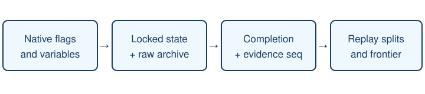

# Story progress through all eight gyms

> Markdown twin of [all-gym-story-milestones-v1.html](../all-gym-story-milestones-v1.html), generated from the HTML by `just explainer-twins`. The HTML is the source; edit it, not this file.

## The game owns completion

Milestones now continue beyond Rock Tomb. The catalog includes the Rusturf rescue, Devon handoffs, Dewford, Steven’s letter, Slateport’s museum, the Route 110 rival and Mauville. Every later gym has separate entry, leader victory, gym completion, badge and TM splits.

These are measurements. The model’s readout, tools, goals and stall clocks are unchanged.

## Gym coverage

| Gym | Leader | Badge | TM |
|---|---|---|---|
| Rustboro | Roxanne | Stone | Rock Tomb |
| Dewford | Brawly | Knuckle | Bulk Up |
| Mauville | Wattson | Dynamo | Shock Wave |
| Lavaridge | Flannery | Heat | Overheat |
| Petalburg | Norman | Balance | Facade |
| Fortree | Winona | Feather | Aerial Ace |
| Mossdeep | Tate and Liza | Mind | Calm Mind |
| Sootopolis | Juan | Rain | Water Pulse |

Optional trainers remain diagnostic, except the three existing Rustboro trainer splits. Locations and story events may occur in a different order; a missing split stays missing.

## Historical recovery

Original event logs and frames stay unchanged. A derived sidecar binds the source log prefix and every recovered state to its archived RAM hash and ROM identity. The viewer independently validates the recovery. Older live runs that have been backfilled continue to acquire derived splits from their newly archived samples.

Evidence and limits

A recovered time is the first confirmed observation, an upper bound on completion. A resumed save does not earn events already completed at load. Unlocking Match Call is separate from finishing its tutorial. Peeko’s rescue completes after Briney and Peeko leave, not when the grunt battle starts. Later gym predicates are source-grounded and tested; an unplayed gym has no gameplay result.

Source: pret/pokeemerald 731ad5bfd6e6f265508d0efcca0ba42f9dcf5881, US Emerald f3ae088181bf583e55daf962a92bb46f4f1d07b7.

