# How A\* navigation works in our harness and PokeAgent's

> Markdown twin of [astar-navigation.html](../astar-navigation.html), generated from the HTML by `just explainer-twins`. The HTML is the source; edit it, not this file.

Both harnesses give the model a `navigate_to(x, y)` tool. The model always chooses the coordinate. The tool only finds a route and walks it. The two differ in how much of the map they can see and how carefully they walk. Section 1 explains the algorithm itself; the rest compares the two harnesses.

## 1. How A\* works

A\* finds the shortest route across a grid of tiles. It's the same idea in both harnesses; they only differ in what map they feed it and what they do with the answer.

### Three numbers per tile

**g** steps already taken from the start to reach this tile. Known exactly.

**h** a guess of the steps still needed to reach the goal. Both harnesses use Manhattan distance, |Δx| + |Δy|: how far you'd walk if nothing were in the way.

**f** g + h, the estimated length of the whole route if it passes through this tile.

### The loop

1. Put the start tile on the **open list** (tiles found but not yet explored).
2. Take the open tile with the **lowest f**. Ties go to the one closer to the goal.
3. If it's the goal, stop. Follow each tile's **parent** arrow back to the start: that's the path.
4. Otherwise mark it **closed** (done) and look at its 4 neighbours. Skip walls, water, NPCs and closed tiles.
5. For each neighbour, new g = this tile's g + step cost. If that beats any g we had for it, record the new g, set its parent to this tile, and put it on the open list.
6. Repeat from step 2. If the open list runs dry, there is no route.

Because the Manhattan guess never overestimates (you can't beat |Δx|+|Δy| moving one tile at a time), the first time the goal comes off the open list, its route is guaranteed shortest.

### Try it: step through A\* on a small map

Press **Step** to explore one tile at a time. Each explored tile shows g , h and its big f . Turn the heuristic off to see what plain Dijkstra search does: same shortest path, but it wastes effort exploring in every direction.

use the h guess (A\*)

open listclosed (explored)just exploredwallfinal path

### Where each piece lives in the two codebases

| A\* piece | Ours (`navigation.ts`) | PokeAgent's (`pathfinding.py`) |
|---|---|---|
| h, the guess | `distance()`, Manhattan, `:15` | `_heuristic()`, Manhattan, `:1295` |
| g, step cost | always +1, `:49` | +1, or +1.5 on tall grass, `:1223-1234` |
| Open list | a plain array re-sorted by f every loop, `:36` (cheap at 225 tiles) | a binary heap (`heapq`), `:1184` |
| Closed set | best g seen per tile *and elevation*, `:38-39` | `closed_set` of tiles, `:1202` |
| Parent arrows | each node carries its whole path so far, `:49` | `node.parent`, walked back by `_reconstruct_path`, `:1299` |
| No route? | if the goal is off-window, return the path to the explored tile with the smallest h, `:40, :52` | return the explored tile with the smallest h as a partial path, `:1206, :1258` |
| Walkable test | the inline checks in `:43-48` | `_get_neighbors` + `_can_move_to`, `:1260, :824` |

## 2. Same map, two very different views

An illustrative route from the player (@) to the star. Both paths were computed with each harness's own rules. Ours can only see the live 15×15 window, so it heads for the visible tile closest to the goal and spends at most 8 presses per call. PokeAgent's sees the whole map from files on disk and plans the full route.

### Ours: PokeBench

Solid line: the 8 presses this call makes. Faint line: the rest of the local plan, re-planned on the next call once the window moves.

`packages/agent/src/navigation.ts:21` · window from `env/pokebench_env/live_map.py:121`

### PokeAgent's: continual-harness

One call plans the whole route and queues every button. Ledges (chevrons) are one-way, so northbound routes have to go around them.

`env/vendor/continual-harness/utils/mapping/pathfinding.py:1165`

groundtall grasswaterbuildingtreedoor (warp)NPCnot visible to ours

## 3. Where the map data comes from

Ours reads the game's live memory on every step. PokeAgent's rebuilds the map from the pokeemerald decompilation's JSON and only overlays live tiles for a handful of dynamic maps such as Mauville Gym.

## 4. How a plan becomes button presses

This is the biggest behavioral difference. Ours walks one tile, checks what actually happened, and re-plans. PokeAgent's hands the emulator the whole list at once.

### Ours: press, check, re-plan

`navigation.ts:72-104`

### PokeAgent's: plan once, queue everything

`server/game_tools.py:209` · `server/app.py:3581`

## 5. Which tiles each one will walk on

| Tile | Ours | PokeAgent's |
|---|---|---|
| Normal ground | walks | walks |
| Tall grass | walks, same cost | walks, costs 1.5 so it prefers to go around |
| Walls, trees, buildings | blocked (collision bits ≠ 0) | blocked (`#`); Red can Cut adjacent trees |
| Water | blocked, no surfing | blocked, no surfing |
| ⌄ Ledges | blocked both ways | one-way jump in the ledge's direction |
| Doors and warps | only as the goal (doors entered moving UP) | always walkable on Emerald, so routes can pass through them |
| NPCs | always blocked, live positions | blocked by default from the tool |
| Height changes | same elevation only; 0 keeps your layer | elevation rules plus ladder, bridge and cycling-road special cases |

## 6. Two small bugs in PokeAgent's version

The partial-path cap says 25 steps in the comment but the code keeps only 15 (`pathfinding.py:313`).

When A\* finds a cheaper route to a node already in its heap, it lowers the node's cost but never re-sorts the heap (`pathfinding.py:1254`). With grass costing 1.5, it can occasionally return a slightly longer route.

## The trade-off in one line

Ours is short-sighted but safe: the model chains short hops and gets told the moment anything surprises the walker. PokeAgent's reaches much further per call, but trusts static map files and walks blind.

Read from \~/dev/pokebench main at 9accc1e and the vendored continual-harness pinned at bbab97a, 2026-10-14. The map in section 1 is an illustration; the routes on it were computed with each harness's walking rules. This page is fully self-contained and makes no network requests.
