# Auto-talk on the field only

> Markdown twin of [auto-talk-field-only-v1.html](../auto-talk-field-only-v1.html), generated from the HTML by `just explainer-twins`. The HTML is the source; edit it, not this file.

`auto-talk-field-only-v1` · guard · needs `auto-talk-v1` · default OFF · bundle arm only

Auto-talk walks the player to someone and presses A. That only makes sense on the free field. Before this switch, a loop that happened during a battle, an evolution or a menu still made auto-talk "fire": it recorded a `not_free` event on every request, and with `field-ownership-feedback-v1` on it sent a SUPERVISOR note into the battle. The operator, 2026-10-22: "firing auto talk during a battle is a bug that needs to be fixed".

## How often it happened

**318** of 359 auto-talk fires since 10/20 were `not_free` no-ops

| Screen when it fired | not_free events |
|---|---|
| Evolution (battle flag still set) | 157 |
| Battle input | 67 (1 with a SUPERVISOR note sent into the battle) |
| Field yes/no box | 65 |
| Shop menu | 22 |
| Field, controls locked or dialogue open | 7 |

Counted from `runs/2026-10-2*/events.jsonl`, matching each `auto_talk` to the latest recorded state. Only 37 fires talked to anyone.

## Nothing during a battle

*The case `auto-talk-field-only.test.ts` asserts: two requests in a battle record nothing ON, then the first free-field request talks.*

## What counts as a battle, and what else changes

| Game state | OFF | ON |
|---|---|---|
| Battle screen, or the battle flag with no other interface ready | not_free event each request; with field-ownership-feedback-v1, one note naming the battle input | Nothing |
| Evolution decision, field yes/no, shop (an interface the game is waiting on) | not_free event each request; with field-ownership-feedback-v1, one note per interface | No not_free no-ops; field-ownership-feedback-v1, when on, still sends its one note per interface |
| Free field | Talks | Talks (unchanged) |
| A wild battle that starts during auto-talk's own walk | Recorded as not_free with the target | Same |

A post-battle evolution keeps the game's battle flag set (`gMain.inBattle` is cleared only after `TryEvolvePokemon`), so "the battle flag with no other interface ready" is what tells a battle from the evolution decision.

## Status

Default OFF in every preset and in the next-run defaults; not in any arm until the operator adds it. Registered as a pending experiment, not queued or approved. Unit and production-factory tests pass; the cloud review lanes and any measured runs have not happened yet.
