# Auto-talk: skip beaten trainers

> Markdown twin of [auto-talk-v2.html](../auto-talk-v2.html), generated from the HTML by `just explainer-twins`. The HTML is the source; edit it, not this file.

`auto-talk-v2` · guard · needs `auto-talk-v1` · default OFF · bundle arm only

Auto-talk is the loop breaker's last stage: after 3 replies in a row with no tool call, or 8 turns making the same call while the game state stays the same, the harness walks the player to someone on the map and presses A. With this switch on, a trainer the readout shows as defeated is not one of the people it picks.

## What went wrong

In run `2026-10-21T01-16-23_glm53-mac_e9ee`, auto-talk walked to Route 102's Calvin after he was beaten and talked to him (`auto_talk` seq 10359). A beaten trainer only repeats his after-battle line, so the talk told the model nothing new. Auto-talk-v1 already left out unbeaten trainers (talking to one starts a battle), but not beaten ones.

## How a target is picked

*Before and after on the field `auto-talk-v2.test.ts` builds from e9ee's Route 102 (positions and objects as in the test). The test asserts YOUNGSTER OFF and BOY_1 ON for a beaten trainer, and BOY_1 both ways for an unbeaten one.*

## Where "defeated" comes from

The readout's `heal_before_trainers.trainers` list gives each trainer on the map with its `local_id` and `defeated`, read from the game's trainer flags. With the switch on, any object whose `local_id` is in that list as defeated is skipped as a person candidate. The `loaded` field does not matter here; v1's unbeaten filter keeps counting only loaded trainers.

By design, a beaten trainer who is also an untalked story character stays a rank 0 story candidate. The switch is read from the FeatureSet the production `autoTalkContext` factory receives.

## OFF and ON

|  | OFF (before) | ON |
|---|---|---|
| Unbeaten trainer | Skipped | Skipped |
| Beaten trainer | A rank 1 candidate | Skipped |
| When auto-talk fires, its message, its record | Unchanged |  |

## Status

- Commit acc661b8 (M5 GREEN). Not yet merged into main.
- Default OFF. Not in any bundle yet; that waits for Operator's OK.
- Tests: `packages/agent/src/auto-talk-v2.test.ts`. Review round 1: Claude, Grok and GPT lanes LGTM.
- Not yet measured in runs.
