# Auto-talk after a quiet stretch

> Markdown twin of [auto-talk-v3.html](../auto-talk-v3.html), generated from the HTML by `just explainer-twins`. The HTML is the source; edit it, not this file.

`auto-talk-v3` · guard · needs `auto-talk-v1` · default OFF · bundle arm only

auto-talk-v1 only acts on a loop: 8 turns making the same call while the game state stays the same, or 3 replies with no tool call. A model that keeps doing different things on the wrong map never trips it. This switch replaces that trigger with a quiet stretch: ten of the model's turns on one map with no story milestone.

## Why

The 10/22 frontier report: every run that heard MAY's mother ("MAY went out to ROUTE 103") found MAY within 3–8 minutes. The others took 11.5–68.6 minutes; the handoff to Oldale took 34.8 min in 47c3, 28.7 in 13bf and 15.0 in bd06, against 2.7 in 704c. In 47c3 the readout listed her as talked to "5 story milestones since" and the model left her room at turn 97.

**37** talks from 359 auto-talk fires since 10/20, 1 of them to a story character

## Ten quiet turns

*Thresholds and text as in `auto-talk.ts` (`AUTO_TALK_QUIET_TURNS=10`) and asserted by `auto-talk-v3.test.ts`.*

## Who it walks to

*Illustrative layout of the case `auto-talk-v3.test.ts` asserts: WOMAN_4, talked to before a story milestone, comes ahead of a nearer stranger. People say new things once the story moves on; this names no one and no place. Item balls and unbeaten trainers are never picked, as in v1.*

## OFF and ON

|  | OFF (auto-talk-v1) | ON (auto-talk-v3) |
|---|---|---|
| Trigger | 8 identical turns, or 3 replies with no tool call | 10 quiet free-field turns on one map |
| Needs the fixed-point breaker or duplicate-turn collapse | Yes | No |
| Outside the free field | Records not_free | Records nothing |
| Event | `auto_talk`, trigger fixed_point or no_tool_call | `auto_talk`, trigger quiet_map (Activity History, raw inspector; no timeline mark) |

## Status

Default OFF in every preset and in the next-run defaults; not in any arm until Operator adds it. Registered as a pending experiment, not queued or approved. Unit and production-factory tests pass; the cloud review lanes and any measured runs have not happened yet.
