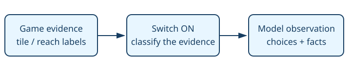

# Available exit presentation

> Markdown twin of [available-exits-presentation-v1.html](../available-exits-presentation-v1.html), generated from the HTML by `just explainer-twins`. The HTML is the source; edit it, not this file.

Keep blocked map facts separate from choices the model can act on.

`available-exits-presentation-v1` — default OFF. Enabled only in the bundle of the two evolving recipes. Control stays OFF.

## Why

A SOUTH connection to Verdanturf was labelled unreachable but remained in the main lists. Duplicated blocked exits can still look like options.

## Evidence controls the list

Existing native reach and water labels → separate confirmed blockage → available or unknown choices plus one unavailable-facts line. State JSON remains intact.

## Same situation, OFF and ON

| OFF | ON |
|---|---|
| Blocked exits stay in map warp lists, interaction candidates and destination lines with warnings. | Confirmed blocked entries leave those choice lists. One Unavailable from here line preserves their identities and reasons without approach or arrival instructions. Unknown reachability remains a candidate under the existing caveat. |

## Wiring

Preset feature → registered server switch → coherent reader / formatter → tool result and recorded observation → supervisor and replay. No automatic game input.

## Game grounding and proof

Existing exit-reachability-v1 flood and surf-gated-exits-v1. No new path planner or route choice.

Native retained Route 104 RAM exercises separation, unknown evidence and reclassification. The existing supervisor and untaken-exit owners already filter using the same reach labels; production tests check those consumers. This change does not guarantee every remaining candidate is traversable.

Limits and status

Implementation candidate on a working branch. Full gates, independent review, landing and served verification are tracked in the worklog. No gameplay benefit claim or new run launch. Existing recorded runs retain their original feature settings.

