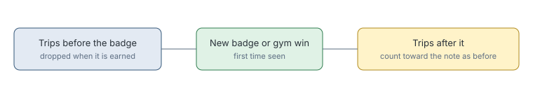

# Badge resets cycles

> Markdown twin of [badge-resets-cycles-v1.html](../badge-resets-cycles-v1.html), generated from the HTML by `just explainer-twins`. The HTML is the source; edit it, not this file.

`badge-resets-cycles-v1` stops the stall note from counting trips made before a new badge.

## Why it exists

Run 37ca was told "You are stalling. You have walked between ROUTE111 and ROUTE112 4 times" 12 turns after the Heat Badge. Seven of those eight moves came hundreds of turns earlier. Only early-game milestones cleared that count, so it ran on stale history after every badge from the third on.

## The rule

*Other later-game milestones leave the count alone.*

## Measured

Replayed through the real stall code on five DeepSeek runs: 22 wrong notes removed and 3 correct ones lost, net. Run 37ca loses 6 wrong notes and no correct ones. The losses are in 274b, during travel after a badge. Resetting on every story milestone was worse: 28 removed, 21 lost.

## Off

Trips made before a badge keep counting after it.
