Harness switch · guard · `bag-healing-items-v1` · needs `heal-before-trainers-v1` · agent side only · bundle arm only · off by default

# Heal before trainers: BAG items

> Markdown twin of [bag-healing-items-v1.html](../bag-healing-items-v1.html), generated from the HTML by `just explainer-twins`. The HTML is the source; edit it, not this file.

The model could see its POTION all along, but nothing ever connected it to the weak lead in front of a trainer. With this switch on, the heal-before-trainers paragraph also names the BAG items that fix the weakness it names, with the game's own description of each, and how the game uses one.

## What the audit found

Read-only forensics on the 12 runs of 2026-10-17 (12:50 AM to 7:38 PM New York), main checkout `runs/`.

- **The model saw the item.** From seq 15989 on, every e046 tool result had `Bag: POTION ×1; POKé BALL ×5; GREAT BALL ×1; TM09 ×1`, on the field and in battle. That line is decoded from the SaveBlock1 bag pockets, with each quantity XOR the save's encryption key. A separate decode of raw-RAM archive `00008958` (the state at seq 16287) gives item 13 (ITEM_POTION) ×1, POKé BALL ×5 and GREAT BALL ×1, so the line was right.
- **In battle it was listed as usable.** battle-details-v2: `BAG allowed — has a battle use (whether it does anything now is not checked): POTION ×1` (e046 seq 16212).
- **The heal advice named no item.** Before the LASS battle the only heal advice the model got was battle-triage's line (seq 16289 and 16362): `Your TORCHIC has 14/38 HP (below half). Talking to the nurse at a POKéMON CENTER heals your whole party; so does talking to MOM at home.` heal-before-trainers-v1 also names only a POKéMON CENTER or MOM ("items are not judged"). Only the Route 103 rival and story-battle warnings name BAG items.
- **battle_action stops at the BAG.** battle-move-tool-v1's `bag` opens the BAG screen and leaves choosing the item to `press`.
- **No model used a healing item.** Across all 12 runs there were 0 real uses. Every POTION that disappeared belonged to the bag the game lends during the Wally catch tutorial (`Party (tutorial)`, for example e046 seq 11843 to 11898). Outside battle no run opened the BAG. In battle the BAG was opened by mistake: e0cc seq 13032 to 13149 pressed into the BAG again and again while trying to choose EMBER. Trainer battles that started with the lead below half and a POTION in the BAG: e046 twice (seq 16138 at 17/38, seq 16400 at 14/38) and e0cc five times (seq 9839, 9885, 12816, 12970, 13032). Once, at e0cc seq 9609, the model's reasoning considered the POTION, and then it battled anyway.



*e046 picked up the POTION at seq 15131 and still had it when it whited out. Red-ringed dots are the two places heal-before-trainers-v1 fires on these recorded states; with this switch on, both paragraphs also name the POTION (test "replays e046 with items on").*

## What the model reads, off and on

Off: heal-before-trainers-v1's paragraph at e046 seq 16287, byte for byte

```
SUPERVISOR: A trainer you have not beaten is on this map: object 3, sprite LASS, at (31,24). Your party is weak for a battle: TORCHIC, your lead, has 14/38 HP (below half). In a trainer battle the game says "No! There's no running from a TRAINER battle!" If your party faints, you black out: you lose half your money (₽2584 of ₽5168) and wake up back at the last POKéMON CENTER you entered, or at home. The nearest place you have been to that heals your party is the POKéMON CENTER in OLDALE TOWN (map 2/2), 4 map changes from here in the game's map table; its nurse says "We restore your tired POKéMON to full health."
```

On: the same paragraph, then one more sentence (exact text from the test, from e046's recorded state)

```
… its nurse says "We restore your tired POKéMON to full health." Your BAG has POTION ×1 ("Restores the HP of a POKéMON by 20 points."). To use one, choose BAG (on the START menu, or on the battle menu in a battle), then the item and USE; the game asks "Use on which POKéMON?"
```

If there are several items, each gets its count and description, in BAG order: `Your BAG has POTION ×1 ("…") and REVIVE ×1 ("Revives a fainted POKéMON with half its HP.").` If the BAG holds no item that fixes a named weakness, the paragraph is heal-before-trainers-v1's unchanged. The sentence names no item the player does not have, and adds no advice about whether to use it.

## Which items it names


*Each weakness heal-before-trainers-v1 names maps to the items whose field use fixes it (`fieldUseFunc` ItemUseOutOfBattle_Medicine or ItemUseOutOfBattle_PPRecovery in src/data/items.h). Status items are not named, because status is not one of the weaknesses. A POTION is never named for a fainted Pokémon.*

| Item | The game's description (item_descriptions.h, line breaks as spaces) |
|---|---|
| POTION | Restores the HP of a POKéMON by 20 points. |
| SUPER POTION | Restores the HP of a POKéMON by 50 points. |
| HYPER POTION | Restores the HP of a POKéMON by 200 points. |
| MAX POTION | Fully restores the HP of a POKéMON. |
| FULL RESTORE | Fully restores the HP and status of a POKéMON. |
| FRESH WATER / SODA POP / LEMONADE / MOOMOO MILK | … restores HP by 50 / 60 / 80 / 100 points. |
| ENERGYPOWDER / ENERGY ROOT / BERRY JUICE | … restores HP by 50 / 200 / 20 points. |
| ORAN BERRY / SITRUS BERRY | A hold item that restores 10 / 30 HP in battle. |
| REVIVE / MAX REVIVE | Revives a fainted POKéMON with half / all its HP. |
| REVIVAL HERB | A very bitter herb that revives a fainted POKéMON. |
| ETHER / MAX ETHER | Restores the PP of a selected move by 10. / Fully restores the PP of a selected move. |
| ELIXIR / MAX ELIXIR | Restores the PP of all moves by 10. / Fully restores the PP of a POKéMON's moves. |
| LEPPA BERRY | A hold item that restores 10 PP in battle. |

The list holds 22 items, and the test checks it against the source. Each description is quoted whole, in the game's words. A berry's description says "in battle" because that is what the game says. The field BAG can still USE a berry, because its `fieldUseFunc` is set.

## How the game uses one, in its own words



*Every label comes from the game: `gText_MenuBag` "BAG", `gMenuText_Use` "USE" in both BAG context menus (`sContextMenuItems_ItemsPocket` and `sContextMenuItems_BattleUse`, src/item_menu.c), and the party menu's `PARTY_MSG_USE_ON_WHICH_MON` = `gText_UseOnWhichPokemon`. The harness already reads these screens: `bag_menu`, `bag_context_menu` and the party menu, each with its highlighted entry.*

## Wiring


*The switch is read only from the run's FeatureSet and passed to the arm. It uses the bag the game server already sends in every state. Nothing changes on the server, in the readout, the prompt or the tools. A test runs the production `playGameTools` with the switch on and off and reads back the run log.*

## Status

- Based on main 0ada6403. Tests are in `packages/agent/src/bag-healing-items.test.ts`; the worklog has the gate results.
- Pending experiment `experiments/bag-healing-items.json`: heal-before-trainers' finals incumbent with heal-before-trainers-v1 on, and only this switch flipped. It is not queued. `experiments/fixed/bundle-v-control.json` is not edited; the bundle owner turns this switch on.
- Not done: no measured runs. Nothing here shows whether the model will actually use the item.
- **A gap this switch does not cover** (proposed as its own switch, `battle-item-choice-v1`): battle_action's `bag` could take an item name, then move the BAG cursor to it, choose USE and pick the party POKéMON, checked press by press the way `fight` is. If the item can't be used it would refuse in the game's words ("It won't have any effect."). This changes the tool interface, so it needs its own A/B.
