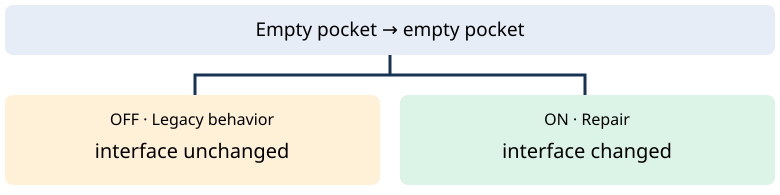

# Bag press feedback

> Markdown twin of [bag-press-feedback-v1.html](../bag-press-feedback-v1.html), generated from the HTML by `just explainer-twins`. The HTML is the source; edit it, not this file.

`bag-press-feedback-v1` · Separate bugfix switch. Omitted presets default OFF; The operator authorized ON in both arms of the current fixed-run recipes.

## What changes

The old press comparison included phase, selection, value and readiness. Two empty pockets both select CLOSE BAG. The repair also compares the verified pocket, bag location, list index and item id.

Only ready, owned bag lists qualify. Raw task arrays and animation counters do not count as change.

## Recorded evidence

Run `2026-10-24T10-22-09_qwen36-gpu0_3b6e`, turn 1360: the readout changes from BERRIES to TMS HMS while the press result says interface unchanged. The paired frame shows BERRIES. Hash-validated raw RAM changes from native pocket 4 to 3.

Source: clean pret/pokeemerald revision `731ad5bfd6e6f265508d0efcca0ba42f9dcf5881`, `include/constants/item.h`, `include/item_menu.h` and `src/item_menu.c`. Matching US ROM SHA1 `f3ae088181bf583e55daf962a92bb46f4f1d07b7`.

Scope and verification

Each repair is independently switchable. Historical logs and pinned runs stay unchanged. Activation uses base.features plus onInBoth; the fixes are excluded from the arm treatment switches.

Regression tests cover OFF behavior, production wiring, the native enum, press comparisons and repeated bag input. Recorded replay establishes mechanism correctness; no gameplay benefit is claimed. Review, landing and served verification are recorded separately in the feature worklog.

