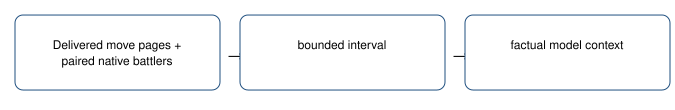

# Observed battle action history

> Markdown twin of [battle-action-history-v1.html](../battle-action-history-v1.html), generated from the HTML by `just explainer-twins`. The HTML is the source; edit it, not this file.

Keep what the game printed beside what the next observation measured.

`battle-action-history-v1` • default OFF • future applicable bundle ON / control OFF.

## What reaches the model

Delivered move pages + paired native battlers → bounded interval → factual model context.

## Recorded example

Native7030: Player TORCHIC used SCRATCH; Foe GEODUDE used DEFENSE CURL; foe HP33/33 →31/33 (net−2). Subsequent SCRATCH intervals measured31→30 and30→29. The model’s damage estimates are not evidence.

This is an offline replay of recorded observations, not a new game or evidence of improved play.

## Bounds and unknowns

At most8 intervals and8 game pages per interval, with at most60 source rows. Earlier whole intervals expire first. Action history fits the remaining 6,000-character budget after comparison text by dropping whole intervals. HP is net change between the labeled battle snapshots. After a whiteout, the last delivered battle-page HP snapshot is labeled separately from the later field observation, whose party may already be healed. Damage attribution to individual moves stays unknown. Critical pages name the last observed move side, otherwise unknown; burn/heal/faint pages retain the game’s words, with player/foe labels from printed prefixes and native names when clear; ambiguous ownership stays unknown.

Delivers on in-battle decisions and once on the first free-field decision after a verified whiteout receipt, then clears; ordinary wins do not re-pin overworld context. Evidence is retained in existing ledger_context rows with exact source event sequences. Nothing chooses a move or a route.

## Source and status

Game reference `731ad5bfd6e6f265508d0efcca0ba42f9dcf5881`: battle_message.c game move and critical-hit text; battle.h B_OUTCOME_LOST=2, B_OUTCOME_WON=1. Native party identity, EXP, moves and HP use the existing reader.

Offline regression and pinned-pi model-input delivery checks. The matching worklog records review and landing status. Gameplay benefit is unmeasured; no GPU queries or new runs are authorized.

OFF preserves existing training/tool/context behavior exactly. Older cook4h/6h/6h-v2 recipes lack the loss comparison dependency and remain unchanged. Frozen campaigns and current workers remain unchanged.
