Harness switch · observation · `battle-details-v2` · needs `expanded-menu-battle-information-v1` · off by default

# Battle details v2

> Markdown twin of [battle-details-v2.html](../battle-details-v2.html), generated from the HTML by `just explainer-twins`. The HTML is the source; edit it, not this file.

In a battle, the readout today lists raw numbers: `status 0/0/0`, `stages (6, 6, 6, 6, 6, 6, 6, 6)`, move names with PP and nothing else. With this switch on it says what each of FIGHT, BAG, POKéMON and RUN will do, gives the game's own refusal message for actions the game can refuse, and spells out types, abilities, items, stats, stages and every move's type, category, power and accuracy for the foe, your Pokémon and the whole party.

## Exact readout, before and after

Both blocks come from the same recorded game memory: run `2026-10-14T22-13-05_think-fast_c406`, raw-RAM archive `00001266`, the PROF. BIRCH rescue with the action menu open on FIGHT. ROM table rows in the test are written from pokeemerald source data because the ROM never enters git.

```
OFF (today, byte for byte; tests/env/fixtures/battle-details-v2-off-c406-00001266.txt)
Bag: 
Battle state: input; input True; turn 1; outcome ongoing
Battler 0 TORCHIC Lv5 HP 20/20; status 0/0/0; stages (6, 6, 6, 6, 6, 6, 6, 6); moves SCRATCH PP 35/35, GROWL PP 40/40
Battler 1 ZIGZAGOON Lv2 HP 13/13; status 0/0/0; stages (6, 6, 6, 6, 6, 6, 6, 6); moves TACKLE PP 35/35, GROWL PP 40/40
Battle input 0: action; ready True; selected FIGHT; target None

ON
Bag: empty
Battle details: WILD single · first battle (PROF. BIRCH rescue) · turn 1 · input ready (action select)
Foe ZIGZAGOON Lv2 · NORMAL · HP 13/13 · status OK · ability PICKUP · item none · stats Atk 6 Def 6 Spe 7 SpA 6 SpD 6 · stages neutral · moves: TACKLE NORMAL physical pow 35 acc 95 PP 35/35; GROWL NORMAL status acc 100 PP 40/40
Actions (2×2 FIGHT BAG / POKéMON RUN; menu open, highlighted ▶ FIGHT): FIGHT · BAG allowed — bag empty · POKéMON switching allowed — no other Pokémon can battle · RUN REFUSED — "PROF. BIRCH: Don't leave me like this!" (first battle)
You TORCHIC Lv5 · FIRE · HP 20/20 · status OK · ability BLAZE · item none · stats Atk 11 Def 10 Spe 8 SpA 13 SpD 10 · stages neutral
Your moves (2×2 1 2 / 3 4; menu not open):
  1 SCRATCH NORMAL physical pow 40 acc 100 PP 35/35
  2 GROWL NORMAL status acc 100 PP 40/40
Party (game party slots):
  1 TORCHIC Lv5 FIRE · HP 20/20 · status OK · ability BLAZE · item none · in battle · moves SCRATCH NORMAL physical pow 40 acc 100 PP 35/35; GROWL NORMAL status acc 100 PP 40/40
```

Bag items with a nonzero battle use are listed as "has a battle use (whether it does anything now is not checked)": the game's item-effect check (for example a POTION on a Pokémon at full HP) is not run, so nothing is called usable. In a Battle Pyramid battle the game opens the Pyramid's own bag (`CB2_BagMenuFromBattle`, item_menu.c), so the BAG action says "Battle Pyramid bag not read" instead of listing the ordinary bag.

Only the battle lines and the empty-bag line change. Battle playback and battle execution lines, the overworld readout and the JSON state used for grading are unchanged. Nothing is shortened.

## The action menu and who can refuse what



*Each action shows a verdict only when the game has a rule that can refuse it. FIGHT never gets one; its notes say when the game takes the choice away.*

## RUN, step by step


*The readout walks the same order as battle_main.c:4319-4350 and IsRunningFromBattleImpossible (battle_main.c:4021-4083) and stops at the first rule that applies. The red-outlined row is the recorded Birch rescue.*

## What it reads

| Fact | Where | Status |
|---|---|---|
| Battle kind (trainer, first battle, link, Frontier, double…) | gBattleTypeFlags 0x02022FEC | verified |
| Types, ability, item, stats, stages, status, volatile status | gBattleMons 0x02024084 (0x58 bytes each), gStatuses3 0x020242AC | verified |
| Move type, power, accuracy | gBattleMoves 0x0831C898 (12-byte rows) | verified |
| Party types and ability | gSpeciesInfo 0x083203CC (28-byte rows) + abilityNum bit 31 of the party Pokémon's misc word | verified |
| Bag item battle use, held-item effect (SMOKE BALL) | gItems 0x085839A0 (44-byte rows), battleUsage +0x20, holdEffect +0x12 | verified table; offsets from struct Item |
| Action and move cursors | 0x020244AC, 0x020244B0 | verified |
| Type and ability names | include/constants/pokemon.h, src/data/text/abilities.h at 731ad5bf | source tables |

## Not read yet (deferred, never guessed)

| Game rule | Why it is not shown |
|---|---|
| Disable, Taunt, Torment, Imprison, Encore, Choice Band lock on a move | Kept in gDisableStructs and gBattleStruct at derived addresses with no ROM literal or raw-RAM receipt. |
| Escape-try counter (runTries) for the odds | gBattleStruct field, derived address. The readout gives only the speed comparison: TryRunFromBattle keeps the odds in a u8 that wraps (battle_util.c:412-466), so a formula without runTries would mislead. |
| ENIGMA BERRY effect for escape | gEnigmaBerries, derived address. RUN says "unknown" when it is held. |
| Battle text box (gDisplayedStringBattle) | Derived address. |
| Script-owned YES/NO prompts ("Use next POKéMON?", learning a move) | Still read as resolving; the script-owned cursor needs a verified owner check first. |
| Battle Pyramid run odds, multi-battle party slots, Safari actions, opponent party size | Need pyramid location, partner slot mapping and enemy party count from unverified addresses. |

## How the switch reaches the readout



*Only the highlighted box behaves differently; the facts are read only while the switch is on (off, the reader is skipped).*

## Status

Tests on recorded raw RAM from runs c406 and c497; the trainer case flips the recorded battle-type flags because no recorded run has reached a trainer battle. Not done: multi-model review, a native probe through a real trainer battle, measured runs. The pending experiment `experiments/battle-details-v2.json` waits on readiness: models must reliably reach battles beyond the Birch rescue.
