Harness switch · battle-loss-recap-v1 · observation · needs ram-state-v1 · default off

# Battle loss recap

> Markdown twin of [battle-loss-recap-v1.html](../battle-loss-recap-v1.html), generated from the HTML by `just explainer-twins`. The HTML is the source; edit it, not this file.

After a whiteout or a lost trainer battle, every game result carries a short factual recap until the next story milestone.

## What it does

After a whiteout, or a lost or drawn trainer battle, every observe, press and navigate_to result ends with one factual recap until the next story milestone: who, where, when, where the game returned the player, and the trainer's defeated flag as that result's own state reads it.



*Run 54a7. The recap starts on the result of the call that ended in the whiteout and stops at the next story milestone. Navigation milestones and measurement-only ones (RIVAL_BATTLE_STARTED) do not end it.*

## Before and after (54a7, T371, tool result seq 8983)

OFF (the recorded result, selected lines): the model saw "GREE whited out!" once, and nothing after it.

```
pressed A
4. turn 371 · ROUTE103 (map 0/18) · battle turn 1: "GREE is out of
5. turn 371 · ROUTE103 (map 0/18) · battle turn 1: "GREE whited out!"
Location: GREE's HOUSE 2F
Party (player): TORCHIC Lv6 HP 21/21 · moves SCRATCH PP 35, GROWL PP 40 · nickname TORCHIC
```

ON (added after the readout, and on every later game result until T611):

```
Battle recap: you lost to MAY (trainer 535) on ROUTE103 (map 0/18) at turn 371 and whited out; the game returned you to GREE's HOUSE 2F (map 1/1). The game shows MAY (trainer 535) has not been defeated.
```

## Facts used

- Outcome: `battle.outcome` "lost" (code 2, gBattleOutcome) in states 8967–8980, then the overworld on LITTLEROOT TOWN BRENDANS HOUSE 2F (map 1/1) at state 8982: a whiteout (pokeemerald `CB2_EndTrainerBattle` → `CB2_WhiteOut` when `IsPlayerDefeated`).
- Trainer: `trainer_opponent` 535 (TRAINER_MAY_ROUTE_103_TORCHIC), ROM name MAY, class 50 (TRAINER_CLASS_RIVAL), from the raw RAM of each state.
- Not defeated: flag 0x500 + 535 unset in the same state. If another trainer becomes the game's last opponent the sentence is left out; once the flag reads set it says "The game now shows MAY (trainer 535) defeated."
- A wild whiteout names the wild Pokémon and has no flag sentence. A won battle, or a run from a wild one, pins nothing. A later loss replaces an earlier one.
- The result that ends the battle is recapped from its own state before the recorder writes it (the recorder records a result's state after the tool returns).

## Measured on recorded runs

| run | results with the recap | turns | false positives |
|---|---|---|---|
| 54a7 | 238 of 655 | T371–T610 | none: one loss (MAY, T371), recap ends at FIRST_POKECENTER_HEAL (T611) |
| sh02 | 0 of 1100 | – | none: sh02 beat MAY at T954 and never whited out |

## Status

Gates: `just test`, `just lint`, `just build`, `just coverage` (90% floor). Replays on recorded runs 54a7 and sh02 only; no measured runs, no live probe (lane freeze until 10 AM). The pending experiment entry is registered, not queued; only the operator approves runs.
