Harness switch · guard · `battle-menu-loop-v1` · no dependency · off by default · bundle arm only

# Battle menu loop

> Markdown twin of [battle-menu-loop-v1.html](../battle-menu-loop-v1.html), generated from the HTML by `just explainer-twins`. The HTML is the source; edit it, not this file.

On the control arm of the cook, a wild WINGULL fight spent 8.9 minutes opening the POKéMON screen and coming back to the same menu choice. The battle never moved. With this switch on, the fourth return to that choice warns. Off: those screens never count.

## The menu the game draws



*The cursor is a 2×2. From POKéMON, the press that reaches FIGHT is UP, then A. LEFT stays on POKéMON, and A there opens the party again.*

## What counts



*One opening of the party or the BAG does not warn. The fourth return to the same choice does, then the supervisor briefing repeats how the menu moves.*

```
The battle menu is back on the same choice after the POKéMON or BAG screen, and the foe's HP and the battle turn are unchanged. The menu reads FIGHT BAG / POKéMON RUN. POKéMON is the bottom-left. UP from POKéMON moves to FIGHT; LEFT from POKéMON does not move. A on FIGHT chooses a move.
```

## The fight it is for

| Run | Window | What happened |
|---|---|---|
| control `a1b1`, 2026-10-17 | turns 961–1128, seq 26192–29641 | Wild WINGULL Lv4 stayed at 17 HP. Battle turn stayed 1. 51 presses of LEFT, A, A. 100 party screens. 8.9 minutes. Fled at turn 1129. |

Across the cook's 726 battles, 6 matched this shape: party screens at least 3, foe HP unchanged, battle turn stayed 1. This one was the longest. `battle-observation-loop-v1` does not see it, because the screen changes between the menu and the party, so the identical-observe count resets. Same-plan on the button string misses it too, because the batches vary.

The fourth return would have fired about 30 seconds in, near turn 970, instead of at the flee on turn 1129.

## Where it is on

Default off, including the viewer's next-run draft. The bundle arm of `bundle-v-control` turns it on. The control arm leaves it off. The pending experiment `battle-menu-loop` is registered and not queued. No standing prompt line was added.
