Feature switch · observation · `battle-message-waiting-v1` · default OFF

# Battle message waiting

> Markdown twin of [battle-message-waiting-v1.html](../battle-message-waiting-v1.html), generated from the HTML by `just explainer-twins`. The HTML is the source; edit it, not this file.

In a battle with no menu open, the readout now says what the battle is waiting for. When a message page waits for A or B, the readout says so and quotes the page whole.

## Why

Cook run #2 (`2026-10-16T02-23-17_qwen36-gpu1_sh02`) called `observe` 272 times in a row, from turn 445 to turn 716. The screen showed "Wild WINGULL fainted!" with the down arrow blinking. The game was waiting for A or B. The readout told the model the opposite: `resolving (no input until the game asks)`. The model believed it and waited. Its first A press after the loop (turn 717) moved the battle on.

The detector behind this switch (`env/pokebench_env/battle_text.py`) reads the battle message window's text printer in RAM. Over the states behind those turns it reports 5 states with the printer idle (the HP bar draining after "TORCH used SCRATCH!") and then 270 states waiting for input on "Wild WINGULL fainted!".

## Before and after, on the recorded RAM

```
OFF (turn 450, raw RAM 4700; byte-identical to what the model received)
Interface: battle_resolving; input not ready; Use the game-owned battle input and selected control when ready
Battle details: WILD single · turn 3 · resolving (no input until the game asks)
```

```
ON (the same RAM, re-rendered on the real ROM)
Interface: battle_resolving; input not ready; Use the game-owned battle input and selected control when ready
Battle details: WILD single · turn 3 · battle message waiting: "Wild WINGULL fainted!" — press A or B to continue
```

*Only the input clause of the Battle details line changes. Every other line is the same. The Interface line is not owned by this switch.*

```
OFF, bundle-v-control's control arm (battle-details-v2 and expanded battle information off)
Battle details: unprovided
```

```
ON, the same arm
Battle details: unprovided
Battle input: battle message waiting: "Wild WINGULL fainted!" — press A or B to continue
```

*Without battle-details-v2 there is no input clause to change, so the switch adds its own line. It adds it only when a message or a YES/NO box is shown and no battle menu is ready. With expanded battle information on, the line follows `Battle state:`.*

## What decides the text



*Checked top to bottom, after two earlier checks: another screen or a ready menu owning input keeps the OFF text, and a failed read says the message state is unknown. The clause replaces only OFF's "resolving (no input until the game asks)". Each case follows the detector's phase: a page printed while another screen owns the battle callback (evolution, bag, party) keeps the OFF text. Under auto-scroll (link and recorded battles) a held page reads "battle message shown: … it moves on by itself".*

## Game grounding

pret/pokeemerald `731ad5bf`, US ROM SHA-1 `f3ae0881`. Addresses and receipts: `docs/findings/2026-10-16_battle-text.md`.

| Fact | Source | RAM read |
|---|---|---|
| Battle messages print in window `B_WIN_MSG` (0) through printer 0 | `src/battle_message.c` BattlePutTextOnWindow | `sTextPrinters[0]` at 0x020201B0: active +0x1B, window +4, cursor +0, state +0x1C |
| `\p` waits, then clears the window; `\l` waits, then scrolls; FC 09 waits in place | `src/text.c` RenderText: RENDER_STATE_CLEAR, \_SCROLL_START, \_WAIT | state 2, 3, 1 |
| Those waits end on `JOY_NEW(A_BUTTON \| B_BUTTON)` unless autoScroll (link and recorded battles) | `src/text.c` TextPrinterWait, TextPrinterWaitWithDownArrow | `gTextFlags` 0x03003014 bit 2 |
| "Wild WINGULL fainted!" ends in `\p` | `src/battle_message.c` sText_TargetFainted (`{B_DEF_NAME_WITH_PREFIX}\nfainted!\p`) | buffer `d1dde0d800…abfb`, cursor 22, state 2 |
| A battle-script YES/NO box: UP/DOWN move, A answers, B answers NO | `src/battle_script_commands.c` Cmd_yesnobox | `gBattleCommunication` 0x02024332 |
| The buffer also holds healthbox names; that is not a message | `src/battle_interface.c` UpdateNickInHealthbox (speed 0, printer stays idle) | text is read only while printer 0 is active on the buffer |

**The page.** The quoted page is the text written since the window was last cleared (`\p`), up to the next wait the player has not answered yet, or to the message's end. Just after A or B, while the printer starts the next page, the quoted page is that next page. Line breaks become spaces. Control arguments are skipped, so an argument byte is never taken for a page break. Nothing is clipped. The page is recorded in the state JSON as `battle.message.page`; the state JSON is the same with the switch on or off.

**"Closes on its own" is not read from the script.** The showcase run's raw RAM shows auto messages stay on screen during `waitanimation` as well as `waitmessage`, and an idle printer cannot tell a shown message from a healthbox name in the buffer. So the idle clause states the general fact and quotes no text.

## Proof on recorded runs (real ROM)

Every in-battle state with raw RAM was re-rendered with the run's own switches, with this switch off and on.

| Run | OFF equals what the model got | What ON changed |
|---|---|---|
| cook run #2 `…_sh02` (battle-details-v2 on) | 435 of 435 readouts (288 observe equal, 147 press results contain it) | 270 states: `battle message waiting: "Wild WINGULL fainted!"` (T449–T716). Also waits on "Wild WINGULL appeared!", "Wild POOCHYENA appeared!", "TORCH gained 18 EXP. Points!", "TORCH grew to LV. 6!", "Got away safely!", "Player defeated PKMN TRAINER MAY!", "GMREEN got ¥300 for winning!"; printing pages such as "TORCH grew to LV. 6!"; idle states read the new resolving text; 118 input-ready states unchanged. |
| showcase `2026-10-16T00-34-26_qwen36-gpu1_show` (battle-details-v2 off) | 191 of 191 readouts | A `Battle input:` line on waiting and printing pages, e.g. "Wild ZIGZAGOON appeared!" (T221), "Wild WURMPLE fainted!" (T517), "ASH whited out!" (T766); 487 states unchanged. |

The golden test `env/tests/env/test_battle_message_waiting.py` holds the RAM windows of raw RAM 4696, 4700 and 4850 (turns 446, 450, 600) and checks OFF byte for byte and ON line by line.

## Wiring



*The highlighted box is the only one whose output changes.*

## Status

- Default OFF. Meant to be ON in both arms of bundle-v-control (the bundle file is owned by the readiness thread).
- Tests, coverage (≥90 on both stacks), lint (known mypy `mgba._pylib` only), build and verify-vendor run; the real-ROM tests ran with Operator ROM.
- Not done here: measured runs; the loop guard's battle blind spot (another thread); the Interface line's "input not ready", which is not owned by this switch.
- The YES/NO box clause rests on pokeemerald source (`Cmd_yesnobox`, `Cmd_yesnoboxlearnmove`, `Cmd_yesnoboxstoplearningmove`, `Cmd_trygivecaughtmonnick`) and synthetic tests only: no recorded run has shown a learn-move, nickname or switch-offer box. It is kept because without it such a box would read "no input until the game asks", the same observe-loop bug.
