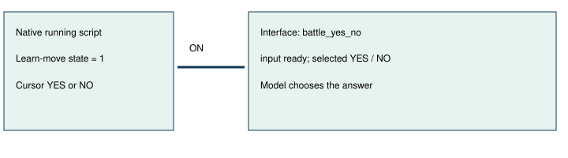

# Battle move-learning input

> Markdown twin of [battle-move-learn-input-v1.html](../battle-move-learn-input-v1.html), generated from the HTML by `just explainer-twins`. The HTML is the source; edit it, not this file.

October 22 Frontier mistake E14 / defect B6. Candidate only; no experiments launched.

## A question can own input during battle

OFF keeps the preceding battle controller interface: battle_resolving; input not ready. ON corrects the native interface JSON, rendered Interface line and action-history menu owner. The separate post-battle readout already corrected displayed text in its own ON arm; this switch fixes the underlying owner too.

## What qualifies

Only an active battle with a verified running battle script, opcode 0x5A or 0x5B, learnMoveState 1 and cursor 0 or 1. Unknown owners, unready transitions, other YES/NO prompts and evolution remain unchanged. No input is sent.

Game source: pret/pokeemerald revision 731ad5bfd6e6f265508d0efcca0ba42f9dcf5881, src/battle_script_commands.c, Cmd_yesnoboxlearnmove and Cmd_yesnoboxstoplearningmove. UP or DOWN changes the cursor; A answers; B answers NO.

## Evidence and limits

Recorded raw RAM from run 97a0 includes both learn and stop-learning questions. Report archive d548 / 00008798 independently confirms a ready learn-move question. Synthetic cursor/state patches cover YES, NO and non-ready states. Existing evolution result tests cover decline and learned-result pages separately.

Default OFF. Bundle ON and control OFF. No claim of gameplay benefit; no cohort approved or started. Browser and cloud review receipts remain in the worklog.
