Harness switch · guidance · `battle-move-tool-v1` · needs nothing · off by default · bundle arm only

# Battle action tool

> Markdown twin of [battle-move-tool-v1.html](../battle-move-tool-v1.html), generated from the HTML by `just explainer-twins`. The HTML is the source; edit it, not this file.

A tool call for the battle menu instead of a button path. The model calls `battle_action` with what it wants (FIGHT with a move name, BAG, POKéMON or RUN) and the harness presses the buttons one at a time from the cursor the game holds in memory, checking each step, the way `navigate_to` walks. It never presses blindly: when anything is not as planned it stops and says what the game shows. The operator, 2026-10-17: "have tool calls for the battle … pass in the appropriate arguments … Maybe that'll be more reliable."

## The misses it targets

Run `2026-10-17T13-15-36_qwen36-gpu1_e046`, turns 593–597 (seq 16607–16772): five turns in a row the model thought "I will use Ember" and pressed `A, RIGHT, A, A`. The move menu opened on SCRATCH (top left, 0 PP), so RIGHT highlighted GROWL; the battle journal recorded GROWL five times while TORCHIC fell from 8 to 2 HP. EMBER is the bottom-right slot.

Run `2026-10-17T11-15-07_qwen36-gpu0_0e05`, turns 770–861, a trainer battle: from RUN the model pressed `LEFT, LEFT, DOWN, DOWN, A` to reach FIGHT and EMBER. The first LEFT reaches POKéMON, the rest do nothing, and A opened the party screen. It backed out with B and repeated the same two batches for 92 turns.

## The move menu at e046 turn 593



*Red dashed: the recorded path. Green: the path battle_action presses, one button per press, columns first. The moves, PP and cursor are the recorded state at seq 16616.*

## Before and after

Off (recorded, e046 turn 593)

```
tool call: press {"buttons":["A","RIGHT","A","A"]}

pressed A, RIGHT, A
…
1. turn 593 · battle turn 6: "TORCHIC used
GROWL!"
2. turn 593 · battle turn 6: "Foe SHROOMISH's ATTACK
fell!"
```

On (same state, replayed in the test)

```
tool call: battle_action {"action":"fight","move":"Ember"}

Battle action: chose FIGHT, then EMBER; buttons pressed:
A, RIGHT, DOWN, A; the battle is running its own text
or animation.
(then the screen, the readout and, with battle text
auto-advance, the turn's battle messages)
```

The ON text is the tool's actual first line from the e046 test, which starts at the recorded state (seq 16609) and simulates the menu with the game's cursor rules. The simulated move menu is checked against the recorded move-menu states (seq 16616 and 16622) field for field. No real-ROM probe has driven the tool yet: the offline probe (the tool against mGBA on a saved battle, no server) was refused by this session's permissions, so the cursor rules rest on the pret source and the recorded states above.

## One call, step by step



*At most 12 presses per call (the longest path is B, then two cursor moves and A, two cursor moves and A, then three target moves and A). No sleeps or polling inside the tool: every press is the ordinary press tool, and the only waits are the server's frame-counted battle wait.*

## The tool the model gets

```
battle_action(action: "fight" | "bag" | "pokemon" | "run", move?: string, target?: string)

move: with fight, the move name as the battle shows it (EMBER). Case, spaces and
hyphens do not matter ("focus energy" = FOCUS ENERGY); otherwise it must match one
of the active POKéMON's moves.
target: with fight in a double battle, the POKéMON the move hits: its name as the
battle shows it, or foe left / foe right (as on the screen), ally, self.
```

| Situation | Pressed | First line of the result |
|---|---|---|
| Move with no PP | nothing | Battle action: nothing pressed: There's no PP left for this move! (SCRATCH has 0/35 PP) |
| Move the POKéMON does not know | nothing | … TORCHIC does not know TACKLE; its moves: SCRATCH (PP 0/35), GROWL (PP 38/40), FOCUS ENERGY (PP 30/30), EMBER (PP 13/25). |
| fight with no move | nothing | … name the move to use; TORCHIC's moves: … |
| Message waiting (0e05 seq 18947) | nothing | … the battle is not waiting for a choice; a battle message is waiting for A or B: "No! There's no running from a TRAINER battle!" |
| Not in a battle | nothing | … no battle is in progress. |
| run in a trainer battle | A | Battle action: chose RUN; buttons pressed: A; a battle message is waiting for A or B: "No! There's no running from a TRAINER battle!" |
| bag / pokemon | to BAG or POKéMON, then A | … chose BAG; buttons pressed: RIGHT, A; the game is showing another screen (bag_menu); choosing an item there is up to you. |
| Every move at 0 PP | A on FIGHT | … chose FIGHT (every move has 0 PP; the game picks what TORCHIC does); … |
| Double battle, single-target move, no target | nothing | … EMBER needs a target in this double battle; name one of: WURMPLE (ally, screen right), ZIGZAGOON (foe, screen left). |
| Double battle with target | A, RIGHT, DOWN, A, RIGHT, RIGHT, A | Battle action: chose FIGHT, then EMBER for TORCHIC, at ZIGZAGOON (foe, screen left); …; the battle menu (FIGHT, BAG, POKéMON, RUN) is open for WURMPLE; highlighted FIGHT. |
| Spread move with a target | A, RIGHT, A | … chose FIGHT, then GROWL for TORCHIC; buttons pressed: A, RIGHT, A; target ignored: GROWL hits both foes; … |
| Input changed before a press | nothing more | … stopped; the battle input changed before the press, so no button was sent; inspect the new state. |

Game words: "There's no PP left for this move!" is `sText_NoPPLeft` and the menu labels are `gText_BattleMenu` ("FIGHT BAG / POKéMON RUN"), both in pret `src/battle_message.c`. Where the game shows nothing (a move the POKéMON does not know, a battle still busy), the line says only the observable fact. Messages the game shows after a press (no running from a trainer battle, a disabled move) are quoted from the battle message window.

## How much it would prevent

| Recorded failure (all 288 runs, read-only count) | Count | With battle_action |
|---|---|---|
| Model text names one of its moves ("use EMBER"), the committed move is another | 34 of 797 such choices (4.3%), in 9 runs: 0e05 8, e046 7, f551 4, 4495 4, eae2 4, 230d 3, 7a95 2, c497 1, 93eb 1 | all 34, when the model passes the move it names: the cursor is driven from RAM and checked |
| 5+ press calls while the action or move menu waited, no choice committed | 8 stretches, 108 calls; longest 0e05 T768–863 (64 calls) | one call reaches the move; a call that cannot says why |
| "There's no PP left for this move!" shown | 5 (all 0e05) | refused before pressing |
| Items or party POKéMON chosen in battle | 0 (move 1227, run 93) | not needed in v1: bag and pokemon only open the screen |

The counts are an upper bound on what the tool can fix: it helps only when the model calls it. Whether models do, and whether that moves milestones, is what the pending experiment measures.

## Scope in v1, from the evidence

- **BAG and POKéMON open the screen and stop.** No recorded run has ever chosen an item or a party POKéMON in battle; the bag and party screens have their own cursors, lists and confirmations, which press still drives.
- **Double battles** (the operator, 2026-10-17 4:18 PM: "the battle tool needs to be able to select which pokemon should be attacked"): the game asks for each of your POKéMON in turn: the right one only after the left one has chosen (pret `HandleTurnActionSelectionState`). One call acts for the POKéMON being asked and names it ("chose FIGHT, then EMBER for TORCHIC, at ZIGZAGOON (foe, screen left)"), and its result says who is asked next ("the battle menu … is open for WURMPLE"). Two inputs ready at once does not happen in these battles; if it ever does, the tool presses nothing, because one button reaches both.
- **Targets:** a move whose target type (ROM move table, byte 6 of `struct BattleMove`) is MOVE_TARGET_SELECTED needs `target` while more than one other POKéMON is present. The choices are every present battler but the user, labelled by side and by where the screen draws it (pret `sBattlerCoords`: your POKéMON left and right, foes left and right). A missing, unmatched or ambiguous target is refused with the list. The highlight is moved with RIGHT only (forward through `sTargetIdentities`; the retail LEFT wrap reads past the array) and checked after each press. Spread moves (both foes, everyone), self moves, CURSE for a non-GHOST user, random-target moves, a battle with one other POKéMON left and single battles ignore `target` and say so. No recorded run has reached a double battle yet, so the tests use synthetic double-battle states built from recorded rows.
- **Not read:** Disable, Taunt, Torment, Imprison and Choice Band locks. If the game refuses such a move after A, the result quotes the game's message.
- **Not handled:** the Safari Zone menu, battle YES/NO choices and the move reorder (SELECT) choice. The tool refuses and names what is open.
- **Field-only blocks** (untaken exits, people ledger, ID cards, story destinations) are not added to a battle_action result; battle-loss recap and blocked-exit facts are.

## Wiring


*Only the highlighted box changes behavior. Off: withBattleAction returns the tools unchanged, so the tool list, every tool description and the system prompt are byte-for-byte today's (tested). The recorder pairs each battle_action result with its state; button presses carry the battle_action call id; the game's own battle_choice journal records what was committed.*

## Status

- Default off; registered as the pending experiment `experiments/battle-move-tool.json` (not queued). Bundle arm only; the bundle file is owned elsewhere and not edited here.
- Tests: recorded e046 and 0e05 states, every refusal, precondition and cursor-check stop, production factory over HTTP, auto-advance hand-off, OFF byte-identity.
- Not done: a real-ROM probe (refused by the session's permissions; see above) and measured runs. Whether this helps is for the experiment to show.
