Harness switch · guard · `battle-observation-loop-v1` · no dependency · off by default · bug fix: ON in both arms

# Battle observation loop

> Markdown twin of [battle-observation-loop-v1.html](../battle-observation-loop-v1.html), generated from the HTML by `just explainer-twins`. The HTML is the source; edit it, not this file.

In sh02 the model called `observe` 270 times in a row during a wild battle while the game waited for a button, and the loop guard never fired. With this switch on, an observe that finds the battle exactly as the previous call left it counts toward the observation guard, so the fourth identical observe warns. Off: observes in battle never count.

## Why

| Run | Window | What happened | Loop guard (today) |
|---|---|---|---|
| `sh02` (2026-10-16) | T445–T716, seq \~9950–11928 | WINGULL at 0/13 HP; the battle waits for A. The model observes 270 times. | silent; only `milestone_drought` at T716 (seq 11928) |

Cause, confirmed by replay: `semanticState` returns no fingerprint in battle, and the observation counter only counts an observe whose fingerprint equals the previous one, so it reset to 0 on every observe. The decoded battle was byte-identical in all 268 state snapshots from seq 10056 to 11928.

## Unchanged versus advancing



*Top: the recorded sh02 observes (the counter needs 3 repeats, `LOOP_POLICY.observation`). Bottom: the synthetic cases in the tests, built from the recorded battle state.*

| Compared between consecutive game calls | Why |
|---|---|
| the whole decoded battle: phase, ready, turn, outcome, every battler (HP, PP, status, stat stages), input phases and cursors, controller flags, main function, script pointer, signals, current move execution | any change means the game moved on without the model |
| the active menu, the party, the field message | a menu or message change is progress too |
| a battle decoder diagnostic, or no battle readout | unknown: never counts |

A press resets the count as today. A battle state not seen in the last 16 calls is new and recovers the episode. The rule uses game state only, never time.

## What the model reads

```
LOOP GUARD (observation): Repeated observations contain no new reliable game information. Reassess whether an interaction is needed; unchanged observations are not recovery. Recovery is bounded; objective wording and new evidence IDs alone do not establish progress.
```

With the supervisor on, as in both arms, the next call gets the supervisor briefing for observation ("You keep repeating observing without acting…"), re-posted every 6 calls. The battle readout text itself is unchanged here; the "resolving" wording is handled on a working branch.

## Replay receipts

| Window | OFF | ON |
|---|---|---|
| sh02 T445–T718 | no notice | warning + supervisor T452 seq 10079; 45 supervisor briefings to T716; recovered T717 seq 11945 when a press moved the battle on |

In a sweep of the 60 most recent runs only sh02 gains a battle warning. Only sh02 (284) and one other run (1) observe in battle at all, so the evidence for the no-false-positive rule is the synthetic cases plus sh02's 15 in-battle observes where the battle had changed.

## Status

Tests in `packages/agent/src/battle-observation-loop.test.ts` and a `live.ts` factory test. Ships with [push-back loop detection](pushback-loop-detection-v1.md). No measured runs.
