Harness switch · guidance · `battle-text-auto-advance-v1` · needs `dialogue-auto-advance-v1` · off by default

# Battle text auto-advance

> Markdown twin of [battle-text-auto-advance-v1.html](../battle-text-auto-advance-v1.html), generated from the HTML by `just explainer-twins`. The HTML is the source; edit it, not this file.

Battle messages advance the way field dialogue already does. The harness presses B on each battle message that waits for a button, and the game server holds every other wait until the first emulated frame the battle needs the model again. The model sees one result per decision, with every battle message listed.

## Why

In the showcase run `2026-10-16T00-34-26_qwen36-gpu1_show`, seven wild battles took 19 to 37 turns each. Most turns were a single A press answered `interface unchanged` while the battle phase read `resolving`: the model was pressing into messages that advance on their own. Field auto-advance stopped at "a battle started" and did nothing inside the battle.

## Off and on, one battle turn



*The recorded turns 722–726 (event seqs 18431–18487) and the same start replayed with the switch on (test `battle-text-auto-advance.test.ts`, raw RAM 7765 → 7782). One B press, two inputs dropped, a stop at the action menu.*

## What the game does (pret/pokeemerald 731ad5bf)



*Recorded evidence from the showcase run's raw RAM: at 7765 the buffer holds `WURMPLE♀` (healthbox) with printer 0 idle; at 7772 printer 0 waits at cursor 23 on `Wild WURMPLE appeared!`. A and B both advance (`JOY_NEW(A_BUTTON | B_BUTTON)` in `text.c`); B is used, as field auto-advance does. Findings: `docs/findings/2026-10-16_battle-text.md`.*

## Where it stops

| Game state | Stop | Result says |
|---|---|---|
| Action or move menu owner ready | `battle_input` | the battle action menu is ready (FIGHT, BAG, POKEMON, RUN); highlighted FIGHT |
| Battle-script YES/NO in state 1 (`yesnobox`, learn move, stop learning, nickname a catch) | `battle_prompt` | a battle YES/NO question is open (…); highlighted NO; B answers NO |
| Bag, party, summary or naming screen; evolution | `menu` / `naming` / `screen_change` | the open menu or screen |
| Battle over, field back (CB2_Overworld, no fade) | field auto-advance continues | Birch's thanks, a blackout message, then field free |
| 50 presses or 90 s in the call (shared with field auto-advance) | `press_cap` / `time_cap` | AUTO-ADVANCE CAP … |
| 3 waits of 600 emulated frames in a row with nothing to press | `battle_busy` | the battle kept running on its own … |
| Operator pause | `paused` | the game is paused … |

## Waits come from game frames


*No sleeps or polling inside a battle: the server holds each wait until a frame where a page waits, an input or YES/NO owner is ready, another screen opens, or the field is back, bounded at 600 frames. Field waits after the battle are field auto-advance's, unchanged.*

## Real ROM: Birch rescue battle (recorded)

Production tools from the built branch, from a save at the starter confirmation; calls `A`, then `A,A` three times. Receipts: `docs/findings/2026-10-16_battle-text-proof.md` (tracked copy; full JSON in the ignored `runs/battle-text-qualify/m3-birch.json`).

```
call 1  A    → B ×1 · stop: action menu ready, FIGHT
             1. battle turn 1: "Wild ZIGZAGOON appeared!"
             2. battle turn 1: "Go! TORCHIC!"
call 2  A,A  → B ×0 · stop: action menu · "TORCHIC used SCRATCH!" · "Wild ZIGZAGOON used GROWL!" · "TORCHIC's ATTACK fell!"
call 3  A,A  → B ×0 · stop: action menu · "TORCHIC used SCRATCH!" · "Wild ZIGZAGOON used TACKLE!"
call 4  A,A  → B ×2 in battle, 13 in the field · stop: menu field_yes_no (YES, NO; YES highlighted)
             "TORCHIC used SCRATCH!" · "Wild ZIGZAGOON fainted!" · "TORCHIC gained 17 EXP. Points!"
             then 15 field pages: Birch's thanks on Route 101, the lab, "AA received the TORCHIC!",
             "PROF. BIRCH: While you're at it, why not give a nickname to that TORCHIC?"
```

## Real ROM: wild battle on Route 101 (recorded)

From a save in the Route 101 grass with TORCHIC; walking LEFT/RIGHT one step per call until the 14th step started a battle, then `A,A` per turn. Receipts: `docs/findings/2026-10-16_battle-text-proof.md` (tracked copy; full JSON in the ignored `runs/battle-text-qualify/m3-wild.json`).

```
RIGHT → B ×1 · stop: action menu · "Wild POOCHYENA appeared!" · "Go! TORCHIC!"
A,A   → B ×0 · stop: action menu · "TORCHIC used SCRATCH!" · "Wild POOCHYENA used TACKLE!"   (twice)
A,A   → B ×2 · stop: the battle ended and field controls are free
        "TORCHIC used SCRATCH!" · "Wild POOCHYENA fainted!" · "TORCHIC gained 15 EXP. Points!"
```

The whole battle took 4 model calls.

## What the model is told

- System prompt (ON only): a "Battle text auto-advance:" paragraph.
- press and navigate_to descriptions (ON only) say battle text advances the same way.
- Each result: `Battle text auto-advance: the harness pressed B N times …; stopped: …`, dropped inputs, and every page as `N. turn T · MAP (map a/b) · battle turn K: "text"`, whole and in order.
- get_dialogue finds battle pages; the dialogue log, instruction ledger and supervisors skip them.

## Status

- Gates: test, lint, build, coverage (≥90 both stacks), verify-vendor green.
- Pending experiment `experiments/battle-text-auto-advance.json` (activation STARTER_CHOSEN, primary OLDALE_TOWN); joins the bundle arm of bundle-v-control by operator decision.
- Not visited on the real ROM: learn-move and nickname YES/NO boxes, the switch offer, a double battle, a blackout. Covered by source reading and tests only.
- No measured runs yet.
