Harness switch · guidance · `battle-triage-guidance-v1` · needs nothing · off by default

# Battle triage guidance

> Markdown twin of [battle-triage-guidance-v1.html](../battle-triage-guidance-v1.html), generated from the HTML by `just explainer-twins`. The HTML is the source; edit it, not this file.

The model fights every wild battle, even when its own Pokémon is nearly fainted. This switch tells it that RUN exists and where it is, when to use it, and where to heal. It also adds one line to the readout when the player's own active Pokémon is below half its maximum HP. The foe's HP never triggers anything.

## Why: the showcase run

Run `2026-10-16T00-34-26_qwen36-gpu1_show` had 7 wild battles and fled none. The party line showed its own HP, for example `TORCHIC Lv6 HP 12/21` at turn 606 and `TORCHIC Lv7 HP 3/23` on the field at turns 739–743, just before it walked into tall grass and started another battle at turn 744. It was at `1/23` at turn 760, fainted at turn 762, and blacked out by turn 768. The system prompt said nothing about running or healing. Its one RUN attempt (turn 611, `RIGHT, A` from FIGHT) opened BAG, because RUN is the bottom-right option. A YOUNGSTER told it three times that a POKéMON CENTER was close by. It never healed.

With this switch on, the field line would have appeared in 51 field readouts of that run (turns 637–743, own HP below half), including 3/23 at turns 739–743. Its readouts in battle showed own HP below half 86 times (turns 624–761); the battle line appears in those only while the battle menu is open, which this count does not check. Turn 606 (12/21) is not below half: 2 × 12 = 24 is more than 21.

## The battle menu



*From FIGHT, RUN is RIGHT, then DOWN, then A. The prompt states exactly this. Grounded in pokeemerald 731ad5bf.*

## What the model sees with the switch on

\1. A section appended to the system prompt by `playSystemPrompt`. It names game rules only, no destination or story step:

```
Battles and healing: you can leave a wild battle with RUN, the bottom-right option of the battle menu (FIGHT BAG / POKéMON RUN); from FIGHT press RIGHT, then DOWN, then A. An escape can fail when the foe is faster; try again. Trainer battles and some story battles cannot be fled. Run from a wild battle when your active Pokémon is below half its maximum HP, or when you are travelling to a story goal and the fight is not needed. Heal before walking into tall grass with a weak Pokémon: talking to the nurse at a POKéMON CENTER heals your whole party, and so does talking to MOM at home.
```

\2. In a battle readout (observe and press results), right after the battle lines (from the recorded c497 battle, wild flags, HP set to 5):

```
Your TORCHIC has 5/20 HP (below half). This is a wild battle: RUN is allowed (bottom-right of the battle menu).
```

\3. In a field readout, right after the Party line:

```
Party (player): TORCHIC Lv5 HP 9/20
Your TORCHIC has 9/20 HP (below half). Talking to the nurse at a POKéMON CENTER heals your whole party; so does talking to MOM at home.
```

The name is the species the party line leads with. "MOM at home" is grounded in `data/scripts/players_house.inc`: once PROF. BIRCH is rescued, talking to MOM runs `PlayersHouse_1F_EventScript_MomHealsParty` ("You look a little tired. I think you should rest a bit."), which heals the party. The bed does nothing, so the copy names MOM, not "resting". The nurse heals through `special HealPlayerParty` in `data/scripts/pkmn_center_nurse.inc`.

## When the battle line appears



*Every condition must hold. When RUN is not allowed, the switch says nothing: the game itself refuses RUN with its own message, battle-details-v2 (when on) prints the refusal, and the prompt already says trainer and some story battles cannot be fled. A "RUN is not allowed" line would add no action.*

## Threshold

| HP | 2 × HP vs max | Line? | Where from |
|---|---|---|---|
| 12/21 | 24 &gt; 21 | no | showcase T606 (battle) |
| 10/20 | 20 = 20 | no (exactly half) | test |
| 9/20 | 18 &lt; 20 | yes | test (field) |
| 5/20 | 10 &lt; 20 | yes | test (c497 battle) |
| 3/23 | 6 &lt; 23 | yes | showcase T739–T743 (field, before the T744 battle) |
| 1/23 | 2 &lt; 23 | yes, if the battle menu is open | showcase T760 (battle) |
| 0/20 | fainted | no | the game asks for a switch, or the field skips to the next Pokémon able to battle |

One owner: `below_half` in `env/pokebench_env/battle_triage.py`, which also holds both lines' copy. The prompt states the same rule in words. On the field the line is about the first party member that is not an egg and not at 0 HP (the one the game sends out first). It is skipped when that member has a decode diagnostic or unknown HP, when every member is fainted (the game's blackout handles that), and when the party belongs to a tutorial or rental owner.

## Wiring



*Green boxes change what the model reads. The RUN rule is one function: battle-details-v2 prints its text, this switch acts on its allowed flag. The server reads battle details when either switch is on; with both off it reads nothing new. The state JSON is unchanged either way.*

## Off

No prompt section and no readout lines. Tests prove the showcase run's recorded system prompt (sha256 `1dbf2e11…`) is reproduced byte for byte with the switch off, that the readout with the switch off equals the ON readout minus exactly the added line, and that battle-details-v2's golden OFF readout is unchanged. Tools, tool descriptions and press results do not change in either state.

## Status

- Default off; it is meant to join the bundle arm of bundle-v-control (that file is edited elsewhere).
- Gates: test, lint (mypy's known `mgba._pylib` worktree error only), build, coverage ≥ 90 on lines, branches and functions in both stacks, verify-vendor.
- The READ EXPLAINER link was clicked in the worktree's built viewer (Harness Config, isolated port 8796) and opened this page.
- Not done: no measured runs; no live probe of the line on the real game server (tests use recorded raw RAM from runs c406 and c497). The re-render test that needs the ROM was skipped in the worktree. Pending experiment entry `experiments/battle-triage-guidance.json` (activation NEW_GAME_CREATED), not designed or queued.
