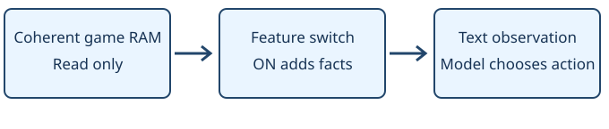

# Berry readout

> Markdown twin of [berry-readout-v1.html](../berry-readout-v1.html), generated from the HTML by `just explainer-twins`. The HTML is the source; edit it, not this file.

`berry-readout-v1` · Independent switch · Default OFF · Bundle ON

## What changes

Visible loaded trees distinguish ripe berries from growing plants. Face the tree and press A to examine it. The game still asks whether to pick them. Type and yield stay undisclosed until the game shows them. Medicinal berries already in the BAG quote the game’s item descriptions.

### OFF · existing observation

```
BERRY_TREE_LATE_STAGES at (3,23)
```

### ON · same saved game state

```
Berry tree at (3,23): berries ready to pick
```

## Game state to model observation



The diagram scrolls horizontally on small screens.

OFF preserves the existing observation. Neither switch changes the game or chooses an action.

## Game grounding and bounds

SetBerryTreeGraphics (src/event_object_movement.c); BerryTree_Text_WantToPick (data/scripts/berry_tree.inc); sCheriBerryDesc through sSitrusBerryDesc (src/data/text/item_descriptions.h). All ten descriptions checked against the exact ROM.

Hidden trees, other maps and trees outside the local 7-tile window are excluded. Missing growth data is unavailable. Empty soil is not labelled ripe. The readout adds no presses, routes or automatic harvesting.

Reference: pret/pokeemerald `731ad5bfd6e6f265508d0efcca0ba42f9dcf5881`; US Emerald SHA-1 `f3ae088181bf583e55daf962a92bb46f4f1d07b7`.

## Evidence and status

Before/after example is from saved GLM run 557c, turn 330, state seq 26833 and delivered frame seq 26834. Offline replay only; the current run was untouched. With both switches OFF, the full 10,523-character observation matches unchanged main byte for byte. State JSON is unchanged across all four combinations.

Separate pending experiments; no queue position or launch. Tests establish readout correctness, not better gameplay. Review and landing status are reported in the chat.
