# Auto-bike

> Markdown twin of [bike-navigation-v1.html](../bike-navigation-v1.html), generated from the HTML by `just explainer-twins`. The HTML is the source; edit it, not this file.

Three switches, all default off, all in the bundle arm only (the operator 2026-11-03: "i agree with ur changes, u can build it"). Together they let the harness use the bike the player already owns: register it to SELECT, get on where riding is faster, and ride navigate_to's straight corridors. The harness never chooses between the MACH BIKE and the ACRO BIKE.

## The three switches

| Switch | What it does | Needs |
|---|---|---|
| `bike-register-v1` | Once, before navigate_to walks: if an owned bike is not on SELECT, register it through START, BAG, KEY ITEMS, the bike, REGISTER, then B back to the field. Adds the readout line `Bike: MACH BIKE registered to SELECT`. | none |
| `bike-navigation-v1` | While riding: straight corridors become bike strides of up to 16 tiles, ridden without B, and a ridden step may cover more than one route tile. | `safe-navigation-strides-v1` |
| `bike-auto-mount-v1` | Before a navigate_to step: press SELECT to get on when riding the planned route is faster than running it; press SELECT to get off before water or a tile a bike cannot enter. The readout line gains `; riding it`. | `bike-register-v1`, `bike-navigation-v1` |

Off: no registration, no SELECT, no bike state or line, and strides stop as soon as they find the player riding, exactly as before.

## Where the work happens

*The agent decides when; the game server owns the frames. Every wait is counted in emulated frames on native state: no sleeps.*

## What the game says

| Fact | Where it is read | pret/pokeemerald |
|---|---|---|
| Owned bikes | SaveBlock1 KEY ITEMS pocket (+0x5D8, 30 slots): MACH BIKE 259, ACRO BIKE 272 | include/constants/items.h |
| What SELECT uses | SaveBlock1.registeredItem (+0x496; SaveBlock1 pointer 0x03005D8C) | include/global.h, item_menu.c UseRegisteredKeyItemOnField |
| Riding | gPlayerAvatar.flags (0x02037590): MACH 0x02, ACRO 0x04; bikeFrameCounter +0x0A, bikeSpeed +0x0B | include/global.fieldmap.h |
| Cycling allowed | gMapHeader (0x02037318) byte 0x1A bit 0, allowCycling (not mapType) | overworld.c Overworld_IsBikingAllowed |
| Tiles a bike cannot enter | behaviors 0x03, 0x0A, 0x28, 0x74–0x77, and the Fortree bridge 0x78 from an even elevation | bike.c GetBikeCollisionAt, IsRunningDisallowedByMetatile |

## Registering the bike to SELECT

*Each press waits for the native menu readout to change. A press with no answer for 30 frames is pressed again (3 tries in all); a screen that takes no input for 150 frames, or anything unexpected, backs out with B and reports why. Budget: 1200 frames. The KEY ITEMS menu is two columns, so REGISTER is RIGHT of USE.*

navigate_to asks for it once for each registration value it sees. If it fails, it is not retried until the registration changes. The result says what happened, for example `Bike: the MACH BIKE is registered to SELECT.`

## Riding a corridor and stopping on its last tile

The game moves a bike only at tile boundaries (bike.c). A held MACH BIKE speeds up through bikeFrameCounter 0, 1, 2: 16, 8, then 4 frames a tile. Released, it keeps going bikeSpeed more tiles (3 at top speed), slowing as it goes. The ACRO BIKE stays at 6 frames a tile and stops on release. B with a direction starts an ACRO BIKE wheelie, so a bike stride never holds B.

*The server's rule (`bike_hold`): hold only if remaining tiles ≥ 1 + counter + counter/2, the bikeSpeed the next step would reach. Tests check every corridor length from 1 to 8 for both bikes: it never coasts past the last tile and always arrives.*

## When it gets on and off

| Straight tiles | Running | MACH BIKE | MACH, get on first | ACRO BIKE | ACRO, get on first |
|---|---|---|---|---|---|
| 5 | 40 | 72 | 93 | 30 | 51 |
| 8 | 64 | 64 | 85 | 48 | 69 |
| 12 | 96 | 80 | 101 | 72 | 93 |
| 16 | 128 | 96 | 117 | 96 | 117 |

Frames for one straight run that stops. Getting on costs about 21 frames. The harness gets on only when this estimate, summed over the planned route's straight runs (up to 16 tiles each), is lower on the bike than running. Only the stretch before the first tile a bike cannot enter counts as ridden, with a get-off added. For a single straight run that means 14 tiles or more on the MACH BIKE and 11 or more on the ACRO BIKE; once riding, later calls pay nothing to get on. It also needs: the map allows cycling, the player is on foot and not surfing, the bike is registered, and neither the tile underfoot nor the next tile is one a bike cannot enter.

It gets off before a step onto water or a tile a bike cannot enter. Entering a map that does not allow cycling (a door into a building) is left to the game, which puts the player on foot itself. Each change is tried once per navigate_to call; if the game refuses, one B closes its message and the walk goes on as it was.

## Rehearsal on the real game (2026-11-03)

Isolated CPU-only game server from the worktree build, bundle-arm features, the real press and navigate_to tools, no model. Saves copied from run `2026-10-25T10-50-57_gpt-6-astra_429f`; originals untouched.

| Case | What happened |
|---|---|
| MACH BIKE, nothing registered, ROUTE 113 (99,8) to (85,8) | registered through the menus, got on, one bike stride of 14 tiles in 91 frames, arrived; the same 14 tiles running took 116 frames (8 + 6) |
| ACRO BIKE (synthetic: the MACH BIKE swapped for the ACRO BIKE on a scratch copy) | registered, got on, 14 tiles in 87 frames |
| FALLARBOR TOWN, riding into the POKéMON CENTER | the game put the player on foot; inside, the map does not allow cycling and a 9-step walk stayed on foot; outside again it got on |
| LAVARIDGE TOWN, riding, then a route ending on a 0x0A tile | 16-tile bike stride in 105 frames (running would be about 128: 16 tiles at 8 frames, computed, not measured here); SELECT got off before the 0x0A tile and the walk arrived on foot |

The rehearsal found three faults the unit fakes did not have, each now fixed and tested: the START menu closing while field controls stay locked, the empty frame between the action's own queue markers, and a list that drops one press after its pocket slides.

Status

Targeted env and agent tests pass. Not yet: the full gate (waits for a CPU window), the multi-model review, landing, any measured gameplay comparison. Nothing here claims the switches help a run; that needs a fixed-run comparison.

