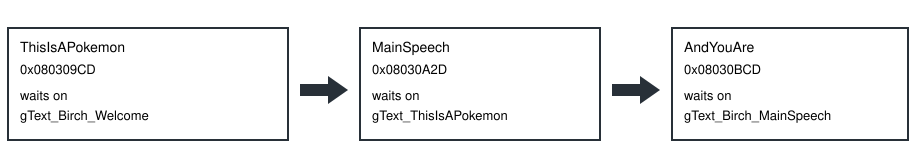

# BIRCH INTRO PAGES

> Markdown twin of [birch-intro-pages-v1.html](../birch-intro-pages-v1.html), generated from the HTML by `just explainer-twins`. The HTML is the source; edit it, not this file.

`birch-intro-pages-v1` is off unless a run turns it on. During PROF. BIRCH's speech before the name is chosen, a page that is waiting for A or B is reported as that page. The switch does not change `birch-speech-pages-v1`, which still owns only the two printers after the name is accepted.

## Who owns the wait

The task that waits is the next function, not the one that loaded the string. Addresses are the US ROM, SHA-1 `f3ae088181bf583e55daf962a92bb46f4f1d07b7`, from pokeemerald `731ad5bf` `src/main_menu.c`.

Screen callback `0x08031679` is `birch_speech`. Printer 0 must be active, its render state 1, 2, or 3, auto-scroll off, window 0 drawn, and the task's sprite fade done (`data[5]`). The cursor is the on-screen page inside `gStringVar4`.

## The same welcome page, off and on

The buffer holds four pages of `gText_Birch_Welcome`. Page breaks are `\p` (`0xFB`). The line break inside the last page is `\n` (`0xFE`). The first page is on screen.

| Line | Off | On, waiting |
|---|---|---|
| Interface | No `birch_intro_page` owner. The menu line is `Menu: unavailable (active owner not verified)`. | `Interface: birch_intro_page; input ready; value Hi! Sorry to keep you waiting!; A or B shows the next page (the value is the page on screen)` |
| Dialog | `Dialog: "Hi! Sorry to keep you waiting! \| Welcome to the world of POKéMON! \| My name is BIRCH. \| But everyone calls me the POKéMON PROFESSOR."` | `Dialog: "Hi! Sorry to keep you waiting!"` |
| Menu | The unavailable line above. | `Menu: no menu choice open (the Interface line says what owns input)` |
| Press result | `unavailable/transitioning (world position unavailable)`. There is no map yet. | `interface changed (phase, selection, value, or readiness changed; input acceptance per frame unproven)` once the value is the next page. |

The next waiting welcome page is `Welcome to the world of POKéMON!`. `MainSpeech` waiting shows `This is what we call a POKéMON.` `AndYouAre` waiting shows `This world is widely inhabited by creatures known as POKéMON.`

## Still printing

Printer state 0 is not a page break. The line is `Interface: birch_intro_page; input not ready; Transition or text printing; selection input is not active`. Dialog stays the buffer. A or B is not reported as ready.

The post-name task `0x0803133D` stays `name_confirmed_transition`, input not ready. This switch does not claim it.

## How the switch gets there

1. The preset names `birch-intro-pages-v1`. Omitted presets and legacy flags keep it false.
2. Off, `POKEBENCH_FEATURES_OFF` lists the id. On, the list omits it.
3. `read_state` passes `birch_intro_pages_enabled` from that list into `read_game_state`.
4. `read_active_ui` returns the page only when the switch is on, exactly one of the three tasks is current, and no later Birch phase already owns the screen.
5. When that page is ready, `dialog` becomes the page value. The press comparison already treats a changed interface value as an interface change. No press-result code is special-cased for this speech.

## Status

Branch `cursor/birch-intro-pages`. Bundle arm only, default off. The pending experiment `birch-intro-pages-v1` has no queue position and is not approved. The probe `2026-10-21T13-33-00_cursor-agent-grok-4.7_probe` is the bug, recorded with the switch off. It is not a measurement of this switch. Review and landing are not done.
