Feature switch · observation · `blackout-readout-v1` · default OFF · bundle arm only

# Whiteout notice

> Markdown twin of [blackout-readout-v1.html](../blackout-readout-v1.html), generated from the HTML by `just explainer-twins`. The HTML is the source; edit it, not this file.

When the player whites out, the readout says so once and the same observation records a durable blackout event: the party had no usable Pokémon left, the game took the player back to the last place they healed, healed the party and halved the money.

## Why

Showcase run, turn 768: the player lost to a POOCHYENA, whited out and woke in BRENDANS HOUSE 2F with ₽1500 instead of ₽3000. The model was told only `Press result: interface changed (…)`. No tool result contained "black", "white" or "fainted". The model saw the frame, then said its next goal was "receive my starter Pokémon" and walked back to the lab (T780–786).

After the loss the game shows no field text at all (`FieldCB_WarpExitFadeFromBlack`), so the readout is the only place the model can learn what happened.

## What the model reads

```
ON, while CB2_WhiteOut runs (show T768, state 19097, re-rendered on the real ROM)
Whiting out: your party has no usable Pokémon left; the game is taking you back to the last place you healed.
```

```
ON, the first readout back on the field (synthetic test of the production server route)
Play time: 1:02:03
Whited out: your party had no usable Pokémon left, so the game took you back to LITTLEROOT TOWN (the last place you healed), healed your party and halved your money: ₽3000 → ₽1500.
```

```
OFF
(no such lines; the frame hook is not installed)
```

*The field line follows the Play time line and appears once. That delivered observation carries one typed receipt; a second observation repeats neither the line nor the receipt.*

## How it is detected



*The latch runs after every game-loop frame the vendor advances through `run_frame_with_buttons` (under its memory lock), like the frame settle, and numbers the frames. Each observation notes that number with the state it reads, and takes the whiteout only if it began on or before that frame: a field-poison whiteout starts from the field, and a field state read just before it must not carry the line. The line and typed receipt are committed together only after the observation has its screenshot and rendered text, and the event is put back if delivery fails. The receipt carries the exact rendered notice. A shared carry preserves every distinct receipt through every observation-replacing composite path—navigation, dialogue and battle auto-advance, and battle actions—so the outer result still gives all of them to both the model and recorder. Ordinary observations use `blackout_receipt`; a composite that consumed several also returns the ordered `blackout_receipts` list. The recorder turns each new receipt into one `activity(kind=blackout)` event; sampling `blackout_active` remains a fallback for old servers. Raw observation-pair writes are serialized at the archive across observation, state and battle-wait routes. Two whiteouts before a field observation queue oldest first; each is said and recorded once. Waits come from game frames; there is no polling or sleeping.*

## Game grounding (pret/pokeemerald 731ad5bf, US ROM f3ae0881)

| Fact | Source | Value |
|---|---|---|
| Whiteout program | `CB2_WhiteOut` (overworld.c:1550), set by the battle's loss path and `SetCB2WhiteOut` | `gMain.callback2` (0x030022C4) = 0x08085F59 |
| What it does | `DoWhiteOut` (overworld.c:358): `SetMoney(money / 2)`, `HealPlayerParty`, `SetWarpDestinationToLastHealLocation` | show: ₽3000 → ₽1500, BRENDANS HOUSE 2F |
| Money | `SaveBlock1.money` XOR `SaveBlock2.encryptionKey` | save1 + 0x490, save2 + 0xAC |

## Limits

- The field line needs the live server's frame latch; re-rendering a single raw-RAM archive offline shows only the "Whiting out" line, from that archive's own state.
- Operator amendment (Operator, 2026-10-16): the latch sees game-loop frames advanced through `run_frame_with_buttons`, the same hook as the frame settle and battle wait. Frames the vendor adapter advances directly, `tick` and the one frame `load_state` runs after loading a state, are out of scope; a state saved on the last `CB2_WhiteOut` frame and loaded shows no field line.
- If the save-block pointers cannot be read on the first whiteout frame, the line says "halved your money" without amounts.

## Status

Improved a working branch; gates in the worklog. The fixed control keeps the switch OFF and the bundle turns it ON. Not measured or launched.
