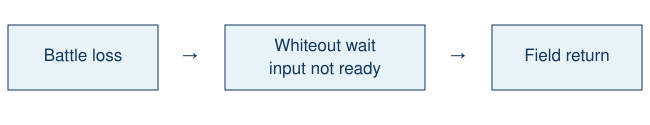

# Blackout transition

> Markdown twin of [blackout-transition-v1.html](../blackout-transition-v1.html), generated from the HTML by `just explainer-twins`. The HTML is the source; edit it, not this file.

Default off · correctness repair under qualification

## A known wait after losing

Emerald's CB2_WhiteOut waits 120 frames before healing and returning to the field. It does not accept a menu choice during this wait. The original campaign recorded this known callback as a coverage error, which conservatively invalidates native grading.

With the switch on, only the verified callback 0x08085F59 becomes a field transition with input not ready. Off preserves the previous model screen and UI bytes. Native measurement independently recognizes the exact known owner; other callbacks still produce coverage errors.

## Evidence and limits

Source: pristine pret/pokeemerald 731ad5bfd6e6f265508d0efcca0ba42f9dcf5881, src/overworld.c, CB2_WhiteOut. The US Emerald ROM SHA-1 f3ae088181bf583e55daf962a92bb46f4f1d07b7 binds the Thumb address. Tests cover the exact owner, adjacent unknown callbacks, the production readout factory and native journal. Historical records remain unchanged. The original trace lacks a full RAM sample during this short wait; a projected fixture is not historical native proof.

No gameplay choice, automatic rematch, prompt advice or score threshold changes.
