Harness switch · guidance · `blocked-batch-result-v1` · needs `press-result-v1` · off by default

# Blocked batch results

> Markdown twin of [blocked-batch-result-v1.html](../blocked-batch-result-v1.html), generated from the HTML by `just explainer-twins`. The HTML is the source; edit it, not this file.

When the model presses one direction several times and the player does not move, the press result now says the player was blocked, where it is standing, which way it faces, and what the readout shows on the next tile. Today the same press reads as "batch or non-direction input", which names no cause.

## 1. What happened in control run 2919

Recorded in `2026-10-15T23-47-41_qwen36-gpu0_2919` (forensics bug 5). The player stood at (10,16) in Littleroot Town, facing left. The lab door warp is at (7,16), and (9,16) and (8,16) are wall. The model pressed `LEFT, LEFT, LEFT` to "walk left to (7,16)". Nothing moved. It got the same unhelpful result, and sent the same batch again: nine LEFT batches from (10,16) in turns 163–183 (eight LEFT×3, one LEFT×2), plus three DOWN×3 batches into the house row at turns 146–151.



*The delivered local map at seq 2431 (the after-state of the turn-164 press), cropped to x 6–12, y 15–17. The readout's `navigation_grid` lists (9,16) with collision 1, the same tile the map draws as `#`.*

## 2. Off and on, word for word

Both lines are produced by replaying the recorded before and after states of seq 2432 (button_press before_state_seq 2422, tool_result state_seq 2431) through `pressResult` with the run's own switches, and with this switch added.

```
Off: unchanged world position/facing (batch or non-direction input; intermediate effects unknown)

On:  blocked: LEFT ×3 did not move you; you are still at (10,16) facing left. The tile to the left, (9,16), is a collision tile (# on the local map), so LEFT cannot move you from here.
```

Turn 163 (seq 2416) started facing down, so the batch turned the player and then went nowhere. Off said `turned down -> left; no net movement`. On says:

```
turned down -> left but did not move: LEFT ×3 left you at (10,16), now facing left. The tile to the left, (9,16), is a collision tile (# on the local map), so LEFT cannot move you from here.
```

All twelve recorded cases reproduce their delivered text byte for byte with the switch off, and all twelve change with it on. The tests replay them from `packages/agent/test-support/blocked-batch-2919.json`.

## 3. When it applies



*Every check reads the same before and after snapshots the press result already uses. Field controls must be read as free (not unknown) in both, so a cutscene or message cannot be mistaken for a wall.*

## 4. What it names, and in what order

The blocker comes only from the before-state's `navigation_grid` (the tiles the local map is drawn from), its object and warp lists, `world_context.objects` on the same map, `topology` and the player's avatar flags. The first match wins. Only terrain the game never lets through from this tile reads `blocked` and ends "so LEFT cannot move you from here". A person, object or warp is described, but the head stays `no movement`: object height is not read, and a warp is not an obstacle. With nothing shown, the head is `no movement` and the cause is not known.

| # | Readout shows | Shown only with | Head | Text after "you are still at (x,y) facing …." |
|---|---|---|---|---|
| 1 | an object on the next tile (same map) | live map | no movement | `The tile to the left, (x,y), has a person or object on it (object id N).` |
| 2 | a warp on the next tile | live map | no movement | `… is a warp (W on the local map) that did not activate from this side.` |
| 3 | an edge wall on the player's own tile, pressed side | one-way tiles | blocked | `Your tile, (x,y), has an edge wall on its left side, so LEFT cannot move you from here.` |
| 4 | next tile past the map edge, no connection that way | world destinations | blocked | `You are at the west edge of this map and it has no connection to the west, so LEFT …` |
| 5 | a ledge that hops another way | ledge hops | blocked | `… is a ledge you can only hop over moving DOWN, so UP …` |
| 6 | collision ≠ 0 (a counter, behavior 0x80, is named as one only with counter talk) | live map | blocked | `… is a collision tile (# on the local map), so LEFT …` |
| 7 | water drawn as \~ (behaviors 0x10–0x15), player on foot and not surfing | live map | blocked | `… is water (~ on the local map); you cannot walk onto it, so LEFT …` |
| 8 | an edge wall on the next tile's facing side | one-way tiles | blocked | `… has an edge wall on its right side, so LEFT …` |
| – | a ledge pressed in its own hop direction (the game hops it) | ledge hops for the word "ledge" | no movement | `… is a ledge you can hop over moving DOWN; what stopped you is not known.` (ledge hops off: `… is drawn as # on the local map; what stopped you is not known.`) |
| – | \~ water while surfing, biking or with unknown avatar flags | live map | no movement | `… is water (~ on the local map); what stopped you is not known.` |
| – | tile not in the window, a height difference, or nothing |  | no movement | `… is outside the readout's map window` or `The readout shows nothing blocking …`, ending `what stopped you is not known.` |

A fact whose switch is off falls back to how the map draws that tile: with ledge hops off a ledge is `#`, so it reads as a collision tile, except when pressed in its own hop direction, which the game allows, so the cause is not known; with one-way tiles off an edge-wall tile is `.`, so the cause is not known. With `live-map-v1` off no tile is named at all: `no movement: LEFT ×3 did not move you; you are still at (10,16) facing left.` With `live-player-position-v1` off, coordinates and facing are dropped (`you are still on the same tile`, `The tile to the left is …`).

## 5. Game grounding

- Collision: pokeemerald `GetCollisionAtCoords` refuses a step onto a tile whose collision bits are set, onto an object at a compatible height (`CheckForObjectEventCollision`), or across an elevation mismatch (`IsElevationMismatchAt`). The readout gives no object heights and does not print tile heights, so neither is claimed.
- Ledges: `MB_JUMP_EAST/WEST/NORTH/SOUTH` (0x38–0x3B) hop only in their own direction. Edge walls: `MetatileBehavior_Is*Blocked` (0x30–0x37, 0xBE, 0xC0, 0xC1). These tables moved unchanged from `navigation.ts` to `tile-rules.ts` so both features read one copy; navigation tests pass unmodified.
- Water: only the behaviors the map draws as `~` (0x10–0x15), and only when `running.avatar_flags` has `PLAYER_AVATAR_FLAG_ON_FOOT` (bit 0) set and `PLAYER_AVATAR_FLAG_SURFING` (bit 3) clear.

## Wiring


*All three callers build their switches with `toolSwitches(features)`, which also passes which map facts the model is shown (live map, ledge hops, one-way tiles, counter talk, world destinations). The highlighted box is the only new behavior; it is reached only when `blockedBatch` is true. Removing the switch from `toolSwitches` turns the factory tests red (checked once, then restored).*

## Status

- Not merged.
- Checks: agent 1318 tests, viewer 786, pytest 1960 pass; lint and build clean (mypy fails only on the unbuilt `mgba._pylib` binding in the worktree); coverage agent 99.04 lines / 94.28 branches / 97.89 functions, all above the 90 floor.
- Review: Codex (gpt-5.6-sol) and Grok (cursor-grok-4.5-high) LGTM after two rounds of fixes (map-switch gating, objects and warps not claimed as blockers, surf water, hoppable ledges).
- Not done: no experiment entry on this branch; it is meant to join the bundle-v-control bundle arm. No measured runs.
