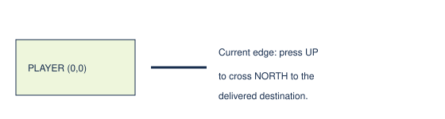

# Current boundary facts

> Markdown twin of [boundary-crossing-facts-v1.html](../boundary-crossing-facts-v1.html), generated from the HTML by `just explainer-twins`. The HTML is the source; edit it, not this file.

E3 repeatedly asked to navigate to the tile already occupied. This adds the missing edge-crossing fact when current native evidence supports it. It sends no input.

## Already here can still be a boundary

Illustrative geometry. The tool reports the direction; the model chooses whether to cross.

## Evidence required

- The model requested its own current coordinate and no movement occurred.
- Exactly one delivered native connection lists this precise edge tile.
- The current foot mask reaches the tile and the matching connection says foot.
- No live matching coordinate trigger occupies that tile.

Blocked connections, unknown reachability, missing edges, ambiguous exits and matching triggers produce the previous result. A fresh call checks current state again; no stale crossing memory is kept.

## ON and OFF

| OFF | ON |
|---|---|
| Unchanged already-here result. | Adds the verified connection button, direction and destination. No input is submitted. |

Default OFF; prepared bundle ON/control OFF. Requires connection-edge-tiles-v1. Missing exit-reachability data withholds the fact. Uses existing delivered topology labels, with no new story facts or route selection.

## Grounding and status

env/pokebench_env/topology.py reads native connections and walkable border edges; its source reference is pret/pokeemerald GetMapBorderIdAt and FillNorthConnection plus the corresponding other sides, revision 731ad5bfd6e6f265508d0efcca0ba42f9dcf5881. When the game shows no text at an edge, the harness states only the observable crossing fact.

Production navigation factory → switch → current edge and reach checks → existing edgeNote → returned tool observation. Existing blocked-exit memory already filters current trigger conditions; no duplicate expiry feature was added.

Synthetic regressions cover production delivery and withholding. Pending unapproved experiment. No gameplay/probes or measured benefit; full integrated review and browser proof remain separate.
