Harness switch · guard · `briefing-exits-v1` · no dependency · off by default · a bug fix meant to be ON in both arms of bundle-v-control

# Briefing exit facts

> Markdown twin of [briefing-exits-v1.html](../briefing-exits-v1.html), generated from the HTML by `just explainer-twins`. The HTML is the source; edit it, not this file.

The supervisor briefings told the model that exits it had just used were untried, and they put the one exit that mattered last, under a bare map number. With this switch on, used exits and triggers the player walked over leave the untried lists, the stall briefing leads with the exits to maps not yet entered and the dialogue of the latest story step, and warp destinations carry the name the readout itself gave them. Off: every briefing is byte-identical to today.

## Why: cook #2 (bundle arm, run `2026-10-16T02-23-17_qwen36-gpu1_sh02`)

| Turn | Seq | What happened |
|---|---|---|
| T113 | 2305 | Entered PROF. BIRCH'S HOUSE 1F (map 1/2) by the door, arriving on (2,8). Last progress of the run (RIVAL_HOUSE_ENTERED). |
| T115 | 2376 | The woman there said “Our daughter is upstairs, I think.” The readout listed `(2,2) -> PROF. BIRCH'S HOUSE 2F (map 1/3)`. |
| T116 | 2384–2394 | Pressed DOWN on the door mat (2,8) and left. Never took the stairs. |
| T134, T171 | 2783, 3616 | Stall briefings listed the door warps (1,8)/(2,8) and the trigger at (2,8) as "not tried yet", and the stairs came last, after 14 PCs and bookshelves, as `Warp to map 1/3`. |

Cause: the briefing marked a target tried only when the model aimed `navigate_to` at it, pressed A facing it, or ended a press on a step trigger in the same room. Leaving or arriving through a warp changed the room, so nothing was marked.

## Which exit a map change used



*Recorded states 2304 (town, 14,8) and 2305 (house, 2,8). Taking the door marks town (14,8) and both door-mat tiles (1,8),(2,8); the trigger at (2,8) shares that tile, so it leaves the list too. The stairs stay untried.*

A warp can lead to its own map (the teleporter pads in pokeemerald `AquaHideout_B1F`, the Trick House puzzles). It counts as used only when the player, from on or next to it, lands exactly on the warp it leads to: a destination warp id indexes the map's own warp events in order. Distance alone cannot tell a teleport from a walk, because a press batch is recorded only at its start and end, and AquaHideout_B1F's pad at (45,5) leads to (45,3), one tile away. The whole doorway left from counts (PetalburgCity_Gym (7,85)/(6,85) both lead to warp 2). The landing warp counts too only when it leads back into that doorway, like a door back; AquaHideout_B1F's warp 12, landed on from warp 14, leads to warp 9, so it stays untaken.

Exits are marked as whole doorways: warps that share one destination (a two-tile door), and side-by-side warps whose destination warps are side by side on the other map (a two-tile gate whose tiles name different warp ids: Route104 (10,30)/(11,30) lead to PetalburgWoods warps 0 and 1, which sit at (14,5)/(15,5)). Two warps next to the player that are different doorways (MtPyre_4F stairs at (12,10) and (12,12), whose 5F ends are two tiles apart): only the one whose destination warp lies next to where the player then stood on the other map counts. With no such evidence, neither is marked.

Warp destinations are read from the game's own warp events (`env/pokebench_env/world.py` `read_targets`: group, number and destination warp id). A door arrival captured one step out of the door (a door exit walks the player down a tile) still finds the door within one tile.

Step triggers: one now counts as tried when two consecutive recorded states on the map show the player moving onto it. Each navigate_to step is recorded; a press batch is recorded at its start and end, so a trigger crossed inside one batch is not seen. Arriving on a trigger through a warp, or standing on one, still does not count (the 2026-10-15 finals rule: a coordinate event runs when the player steps onto its tile, not on a warp arrival). Tried lists still start over when the readout's Story line changes; the exits of the call that changed it stay tried.

## Names come from the readout itself

The briefing collects the names the model's own readouts gave to maps: the Location line for the map it describes, and destinations written `-> NAME (map g/n)` or `Warp to NAME (map g/n)` (named-warp-destinations-v1, world-destinations-v1). A map no readout named keeps its bare id. So in a control arm without named warps, the briefing does not show a destination name the model's readout never showed. Room headers are not this switch's: since a working branch landed, `roomOf` shows the state's `location_display` (the Location line's name), so in new runs both read the same. The sh02 excerpts below predate that, so their headers still show source names.

## What the model reads at T134 (seq 2783), replayed

Off, as recorded (the replay reproduces both recorded messages byte for byte):

```
- Where you are: LITTLEROOT TOWN (map 0/9) at 7,17 facing down
- Last story progress: rival house entered at turn 113 (21 turns ago)
…
- Not tried yet on other maps …: LITTLEROOT TOWN PROFESSOR BIRCHS LAB (map 1/4): Machine at 10,7 (A); … PC at 11,9 (A) | LITTLEROOT TOWN MAYS HOUSE 1F (map 1/2): Warp to map 0/9 at 1,8 (…); Warp to map 0/9 at 2,8 (…); Warp to map 1/3 at 2,2 (…); WOMAN_4 at 3,8 (A); NINJA_BOY at 9,5 (A); coordinate_trigger at 2,8 (step); coordinate_trigger at 1,3 (step); …
- Exits to maps you have not entered since your last story progress: LITTLEROOT TOWN (map 0/9): Warp to map 1/0 at 5,8 | LITTLEROOT TOWN MAYS HOUSE 1F (map 1/2): Warp to map 1/3 at 2,2
Before your next action, …
```

On:

```
- Where you are: LITTLEROOT TOWN (map 0/9) at 7,17 facing down
- Exits to maps you have not entered since your last story progress: LITTLEROOT TOWN (map 0/9): Warp to GMREEN's HOUSE 1F (map 1/0) at 5,8 | LITTLEROOT TOWN MAYS HOUSE 1F (map 1/2): Warp to PROF. BIRCH'S HOUSE 2F (map 1/3) at 2,2
- Dialogue shown with your latest story step that came with dialogue (mom rival instruction at turn 74), whole, in order: … MOM (sprite kind, not a name): "He lives right next door, so you should go over and introduce yourself."
- Last story progress: rival house entered at turn 113 (21 turns ago)
…
- Listed here that you have not tried yet: FAT_MAN at 12,13 (A); BOY_2 at 14,17 (A); coordinate_trigger at 10,1 (step); … (the triggers at 8,9 to 11,9, which recorded steps show the player walking onto, are gone)
- Not tried yet on other maps …: LITTLEROOT TOWN PROFESSOR BIRCHS LAB (map 1/4): Machine at 10,7 (A); … | LITTLEROOT TOWN MAYS HOUSE 1F (map 1/2): Warp to PROF. BIRCH'S HOUSE 2F (map 1/3) at 2,2 (…); WOMAN_4 at 3,8 (A); NINJA_BOY at 9,5 (A); coordinate_trigger at 1,3 (step); coordinate_trigger at 2,4 (step); coordinate_trigger at 3,3 (step); television at 6,4 (A)
Before your next action, …
```

Same lines, same count. Only the order of the stall briefing and the three exit/untried lists change. The loop-guard briefing and the text-only supervisor get the same list fixes and names, in their usual order.

## Where you are, during a battle

The same run, later: the last overworld result was T417 (seq 9644, ROUTE103 at 11,21). The player then walked through grass into a wild battle at (11,13) and every result from T417 to T716 showed the battle. The briefing kept the last overworld snapshot.

|  | milestone_drought briefing, seq 11928 (T716) |
|---|---|
| Off (recorded) | `- Where you are: ROUTE103 (map 0/18) at 11,21 facing right` |
| On | `- Where you are: ROUTE103 (map 0/18) in battle at 11,13` (state seq 11926) |

On, when the latest state shown to the model is a battle, every briefing places the player from that state and says so, without facing; otherwise where you are is the last overworld result, as before. Source: `runs/reports/cook2-navigation.html`.

## Cook harness audit fixes (2026-10-16)

From `runs/reports/2026-10-16-cook-harness-audit/`; each one has a test replaying the recorded run (`briefing-audit.test.ts`).

| Problem (run, seq) | Off (recorded) | On |
|---|---|---|
| Push-back trigger never tried: Oldale (0,10), BlockedPath steps the player back (live 54a7, seq 6785) | `coordinate_trigger at 0,10 (step)` listed after about 30 LEFT presses | tried: the buttons sent were directions only, the first LEFT faced (0,10) from (1,10), the call locked the field or showed dialogue, and the player ended back on (1,10) |
| Dead triggers offered (live 54a7, seq 3091) | `coordinate_trigger at 11,2 (step)` | listed last as `coordinate_trigger at 11,2 (step; its condition did not match when the readout last showed it, so stepping on it then did nothing)`; walking onto it while unmet does not count as trying it, so it is still listed after the story step that enables it |
| People keyed by tile: the MANIAC talked to at (2,10) (sh02, seq 18599, 18701) | `MANIAC at 1,10 (A)`, `MANIAC at 1,11 (A)` | not listed: people are tracked by object id; a conversation counts for the person faced at its first page when the press ended in A or the page is attributed to that faced sprite |
| Menu inputs (show, seq 15203) | `press START … → no change`, `press B … → no change`, `press RIGHT … → no change` | `→ opened the start menu (highlighted POKEMON)`, `→ closed the start menu`, `→ turned up -> right` |
| Tried list wiped by a story change (687e, seq 1494) | `Wall clock at 5,1 (A); … television at 4,1 (A)`, used at t87/t92 | not listed; only people are listed again after a story change |
| Unentered map connection missing (7a95 T375, seq 8935): only Oldale house warps listed | `OLDALE TOWN (map 0/10): Warp to map 2/0 at 5,7; … Warp to map 2/4 at 14,6` | the same warps, then `NORTH edge -> ROUTE103 (map 0/18)` (with world destinations on) |
| Sprite-kind caveat dropped (live 54a7, seq 3091) | `- Characters the readout names here: FAT_MAN at 12,13; BOY_2 at 14,17` | `- Characters the readout names here, by sprite kind (a sprite kind is a graphic, not a personal name): …` |

The push-back rule keeps the finals rule for everything else: arriving on a trigger through a warp, or standing on it while a page shows, is not trying it. A press mixing A or B with directions is never read as a push-back, because the dialogue may be the A. Press-result text and loop detection are not changed here (another branch owns them).

## Wiring



## Status

Tests: `packages/agent/src/briefing-exits.test.ts` (sh02 replay OFF byte-identical and ON, exit-history units, production factories, registry). Pending experiment `experiments/briefing-exits.json`. Meant to be ON in both arms of bundle-v-control as a bug fix; that file belongs to another thread and is not changed here. No measured runs.
