# Align cache window rewrites

> Markdown twin of [cache-aligned-window-v1.html](../cache-aligned-window-v1.html), generated from the HTML by `just explainer-twins`. The HTML is the source; edit it, not this file.

Default OFF. Both experiment arms use this policy when explicitly selected.

## What changes

History can trim up to two turns early when a result-pruning boundary is nearby. The normal minimum retained history remains 11 turns, and the maximum remains 20. Older full results still follow the existing 6-result / 3-result-chunk policy. Dialogue retention is unchanged. Double-window settings scale their existing limits.

For example, an early cut can reduce the visible history from 18 turns to 11 at that request. This removes older text earlier; it does not add memory or images. If no suitable result boundary occurs, the hard history cap still applies. Request boundaries are reconstructed deterministically, including multi-tool batches and text-only replies.

## Why

The previous pair lost history cache at 47 JIT and 51 control pruning requests. Roughly 80% of uncached input occurred at those rewrites. This targets overlapping rewrites, not model choices or game controls. Benefit is unmeasured until the new comparison completes.

## OFF

Reproduces the previous independent result and history cuts exactly.
