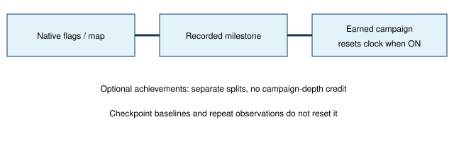

# Campaign progress counts

> Markdown twin of [campaign-progress-clock-v1.html](../campaign-progress-clock-v1.html), generated from the HTML by `just explainer-twins`. The HTML is the source; edit it, not this file.

Campaign arrivals and story completions through the League and game clear. Optional achievements remain separate.

## What changes

The catalog adds 94 campaign milestones and eight optional capability or reward milestones. Slateport beach counts after landing, before Slateport City. Arrival, trainer victory and story completion are separate.

## Switch and measurement

**campaign-progress-clock-v1** defaults OFF. ON: earned campaign milestones reset both wall-time and action drought counts once. OFF: the previous briefing behavior remains. The separate measurement feature records milestones without choosing objectives or routes.

The action clock still uses its existing 30-action threshold; the wall clock retains its five-minute threshold. Optional achievements do not restart the campaign clock.

## Truthful boundaries

The beach excludes boat transit. Route 118 distinguishes the eastern bank from the western approach. Ever Grande distinguishes the landing above the waterfall from the northern League approach. Unknown native data is unknown, not failure or completion.

Evidence and limits

Source: pret/pokeemerald 731ad5bf, US Emerald f3ae0881. Full predicates, source semantics and reset traps are documented in docs/findings/campaign-milestones.md. Space Center and League completion use their actual game-owned evidence; entering a room is not winning its battle.

Historical recovery keeps original logs unchanged and labels first-observation times as upper bounds. A resumed save's initially completed conditions remain present at start. These changes have not been evaluated for gameplay benefit and do not alter active runs.

