Harness correctness · default OFF · bundle ON

# The registration page accepts A or B

> Markdown twin of [caught-dex-input-v1.html](../caught-dex-input-v1.html), generated from the HTML by `just explainer-twins`. The HTML is the source; edit it, not this file.

`caught-dex-input-v1` reads the page displayed after a first catch. It lets the model close it with the controls the game accepts.

## Why it looked busy

The registration page runs inside the battle callback. The standalone Pokédex reader checks a different callback and a menu allocation that this page does not own. The battle reader therefore reported a resolving battle and auto-advance waited three times without sending input.

The fix exposes input; it does not choose a nickname or press through the page automatically.

## Native evidence

Run `2026-10-20T16-14-34_qwen36-gpu1_c6c2`, event 12066, raw RAM 5393, native frame 165639. The paired image in tool result 12067 shows “POKéDEX registration completed.” and ZIGZAGOON.

`CB2_BattleMain = 0x08038421`. The active task is `Task_HandleCaughtMonPageInput = 0x080C0089`; task data\[1\] is national dex number 263. The display number on the Hoenn page is 012. These are different numbering systems.

Source: `pret/pokeemerald` revision `731ad5bfd6e6f265508d0efcca0ba42f9dcf5881`, `src/pokedex.c`. The input handler checks `JOY_NEW(A_BUTTON | B_BUTTON)`. The matching US ROM has SHA-1 `f3ae088181bf583e55daf962a92bb46f4f1d07b7`.

## What is delivered

`Interface: pokedex_caught_entry; input ready; selected POKéDEX registration completed.; A or B closes the registration page`

The input task is authoritative. Display and exit tasks remain transitions. Missing ownership is not readiness; duplicate owners and invalid dex numbers report a diagnostic. The standalone Pokédex remains unchanged.

## Verification scope

Correctness tier: recorded native memory, paired frame, decoder, wait and agent tool regressions. No performance claim and no measured cohort. The pending experiment remains outside the queue.
