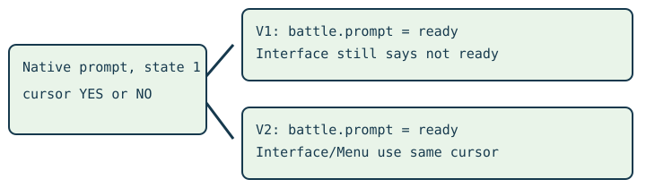

# Caught nickname input V2

> Markdown twin of [caught-nickname-prompt-v2.html](../caught-nickname-prompt-v2.html), generated from the HTML by `just explainer-twins`. The HTML is the source; edit it, not this file.

## The model owns the answer

Emerald asks “Give a nickname to the captured SHROOMISH?” V2 reports the live YES/NO selection consistently. It never chooses an answer, closes registration, or changes the batch safety policy.

V2 projects one verified prompt into the shared interface state. The model still decides what to press.

## Switch contract

`caught-nickname-prompt-v2` requires `caught-nickname-prompt-v1`. Both are enabled in the maintained control and bundle arms, together with `caught-dex-input-v1`. Omitted V2 stays OFF in older presets.

| Setting | Behavior |
|---|---|
| V2 OFF | V1 may recognize the battle question, while the generic Interface/Menu retains its previous readout. |
| V2 ON, ready owner | Interface: battle_yes_no; input ready; selected YES or NO. UP/DOWN selects; A answers; B answers NO. |
| Transition, invalid cursor, other owner | Prior behavior retained; no input readiness invented. |

## Source and recorded evidence

pokeemerald 731ad5bfd6e6f265508d0efcca0ba42f9dcf5881, src/battle_script_commands.c, Cmd_trygivecaughtmonnick. US ROM f3ae088181bf583e55daf962a92bb46f4f1d07b7. State 1 accepts directions, A and B; the script runs under RunTurnActionsFunctions during the thrown-ball action.

Actual Astra recording 2026-10-25T10-50-57_gpt-6-astra_429f: state 5394/raw 4973 has YES; state 5410/raw 4987 has NO; state 8625/raw 7852 has YES. V2 changes ActiveUi only. Existing V1 already stops automatic waiting at the question; existing caught-dex input handles the separate registration page.

## Status

Candidate a working branch. Native archive regression tests reproduce the contradiction and verify V2. Review, landing, served viewer proof and new isolated gameplay proof are separate delivery steps. No measured recording or live run is repaired.
