POKEBENCH · FEATURE EXPLAINER · character-presence-v1 (default OFF)

# Who is actually here

> Markdown twin of [character-presence-v1.html](../character-presence-v1.html), generated from the HTML by `just explainer-twins`. The HTML is the source; edit it, not this file.

The model keeps seeing PROF. BIRCH where he is not. In the stalled Think Fast runs, 14% of turns claimed Birch was present, but no readout ever listed him. The lab aide's sprite kind SCIENTIST_1, FAT_MAN, TWIN and BOY_2 were each called "Professor Birch". This switch adds one line that says which story characters the game itself places on the current map, and which it does not. It names no destination and says nothing about where an absent character is.

## Before and after, in Birch's lab before the rescue



*The same room with the switch off and on. The sprite is still listed as SCIENTIST_1; the new line rules out reading it as Birch.*

## The line, exactly

```
Story characters here (from this map's own object list): MOM at 3,5. Not on this map: PROF. BIRCH, MAY, BRENDAN, NORMAN, WALLY, ROXANNE, STEVEN. Sprite kinds such as SCIENTIST_1 or FAT_MAN are not these characters.
```

A character on the map but more than 7 tiles away is shown as `NAME (on this map, out of view)`.

## Game grounding

| Fact | Where it comes from (pret/pokeemerald 731ad5bf) |
|---|---|
| Objects on the loaded map | `SaveBlock1.objectEventTemplates` at offset 0xC70, 64 entries of 24 bytes (`include/global.h`, `struct ObjectEventTemplate` in `include/global.fieldmap.h`) |
| Hidden objects | a template whose `flagId` (offset 0x14) is set in the save flags (SaveBlock1 + 0x1270) is not spawned, as `FlagGet` decides in the field object code |
| Variable sprites | graphics ids from 240 (`OBJ_EVENT_GFX_VAR_0`) resolve through `VAR_OBJ_GFX_ID_0` (0x4010) and up |
| Which graphics are which character | PROF_BIRCH 64; RIVAL_MAY 105–109; RIVAL_BRENDAN 100–104; MOM 215; NORMAN 129; WALLY 135; ROXANNE 125; STEVEN 134 (`env/pokebench_env/event-graphics.json`). Generic sprites such as SCIENTIST_1 (46) never count. |
| Where each character can be named | A graphics id alone is not an identity: Battle Tent, Battle Frontier and Contest Hall scripts, link play and Route 111's falling-player scene reuse the rival's graphics for other people (for example `SlateportCity_BattleTentBattleRoom/scripts.inc` sets `VAR_OBJ_GFX_ID_1` to `OBJ_EVENT_GFX_RIVAL_MAY_NORMAL` for the opponent). A character is named only on the maps where pret places that story character: map.json object events with its graphics, and for the rival the maps whose scripts call `Common_EventScript_SetupRivalGfxId` (Littleroot, Birch's lab, Oldale, Routes 103/104/110/119, Rustboro, Lavaridge, Lilycove, the Champion's room) plus the two houses. Elsewhere the same sprite names nobody. |
| Failed reads | An emulator read error or a short read gives no line rather than a guess. With the switch OFF the server does not read the object list at all. |
| Live position | the spawned object with the same local id within 7 tiles (`world_context.objects`) |

## Wiring

```
preset / switchboard  →  serverFeatureEnv (POKEBENCH_FEATURES_OFF)  →  game server readout
read_game_state(): story_characters = read_story_characters(save1, map_id, live objects)
format_readout(): prints the line only when "character-presence-v1" is not switched off
```

## Status

Python tests cover hidden characters, live versus out-of-view positions, variable graphics, an unreadable save block, and byte-identical OFF. Not yet measured; it is part of the strong-bundle cohort, from the CLOCK_SET save.
