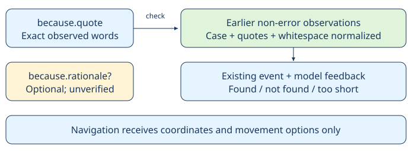

# Quoted destination evidence

> Markdown twin of [citation-evidence-v1.html](../citation-evidence-v1.html), generated from the HTML by `just explainer-twins`. The HTML is the source; edit it, not this file.

`citation-evidence-v1` · Default OFF · Bundle treatment only · Needs `cited-destination-v1`

## Copied words and your explanation are separate

The model selects where to walk. The check establishes whether quoted words appeared in an earlier successful tool result. It does not establish a speaker’s identity or whether the destination follows from the quotation.



## The recorded Briney example

Run `2026-10-24T04-41-40_glm53-mac_4f08`: seq 27606, turn 314, delivered:

```
You can usually find me in my cottage
by the sea near PETALBURG WOODS.
```

Seq 40301/40302, turn 389, supplied the same words surrounded by the model’s “object 1, sprite EXPERT_M (Mr. Briney) is here; he said…” commentary. The entire string was not found. The existing checker already ignores newlines.

### New request format (illustrative conversion of the recorded call)

```
{
  "x": 6, "y": 4, "map_id": [17, 0],
  "because": {
    "quote": "You can usually find me in my cottage by the sea near PETALBURG WOODS.",
    "rationale": "object 1, sprite EXPERT_M (Mr. Briney) is here"
  }
}
```

The quotation matches turn 314. The identity claim in rationale remains unverified. The game’s original text and logs are unchanged.

## ON and OFF

| OFF — incumbent | ON — treatment |
|---|---|
| because is one string; all its text must match. | because.quote is checked; because.rationale is optional and unverified. |
| Original prompt, tool description and miss feedback, including input-cuts behavior. | Prompt explains the object. Every check returns bounded feedback even with input-cuts. |
| Original navigation execution. | Valid requests still walk regardless of citation verdict. Malformed evidence objects are rejected before walking. |

No fuzzy search, automatic extraction from commentary, invented attribution, route choice or destination approval. Two words minimum. Only prior non-error results count; the existing run-lifetime evidence memory and echo removal remain in use. No new cap, truncation or expiry rule.

## Where the evidence goes

The existing `destination_citation` event stores the checked quote in `because`, verdict, found turn, destination and the exact feedback. Original `tool_call` arguments retain rationale. Activity History, trace and raw-event inspection consume the existing event; no timeline marks are added. A found result verifies words only, not speaker identity, rationale or destination.

Status: implementation candidate in a working branch. Recorded-data regression and OFF compatibility tests; review and landing receipts live in the matching worklog. Bundle eligibility is not measured gameplay benefit. No gameplay launched.
