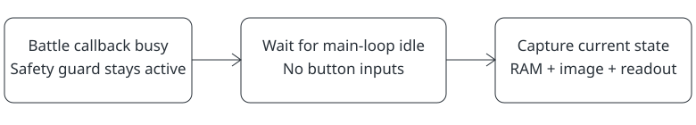

Default OFF · observation repair

# Keep battle damage readouts available safely

> Markdown twin of [coherent-battle-observation-v1.html](../coherent-battle-observation-v1.html), generated from the HTML by `just explainer-twins`. The HTML is the source; edit it, not this file.

`coherent-battle-observation-v1` gives the existing capture owner a short wait for a safe battle snapshot. The model receives current RAM and its matching screenshot together.

*Capture waits; the safety guard stays active. On phones, scroll the diagram sideways.*

## What changes

**OFF:** capture timing stays unchanged. A snapshot taken inside a callback can correctly omit party and battle details, including the damage comparison.

**ON:** during battle, wait until the existing CPU coherence predicate says the game is idle. The existing guard still decides which facts are safe to read. Requires `transition-coherence-v1`.

## A bounded wait

The coherence wait is capped at 60 emulated frames. A two-second wall-clock check also releases an outstanding coherence wait. Existing fade and warp waits keep their own bounds. Waiting lets natural game time advance; it never presses buttons or writes game memory.

Pause or an active input owner releases capture immediately. At a coherence bound or timeout, the observation declares that some readouts may be unavailable and asks the model to observe again. The safety guard can still return a partial readout. Missing native CPU metadata produces an explicit unavailable response.

Evidence and limits

An isolated native emulator replay from a Rustboro Gym checkpoint reproduced the omission with the switch OFF. With it ON, the next safe frame arrived after one emulated frame and restored current party facts and the effective-damage comparison. RAM and screenshot came from that same capture. This is a correctness reproduction, not evidence of more wins or better move choices.

The repair does not recommend moves or train the model. Strategy-support experiments must use this repair equally in both arms after review and source repinning. No experiment is launched by enabling or documenting this switch.

Why the guard remains

Pokémon Emerald's AgbMain callbacks can relocate save blocks or change their encryption key. A host-atomic snapshot can still freeze the guest midway through that work. Waiting reuses the native idle predicate instead of reading through the unsafe interval.

Source grounding: pret/pokeemerald `src/main.c` and save-block relocation code, pinned at `731ad5bfd6e6f265508d0efcca0ba42f9dcf5881`. Runtime ownership remains in `screen_settle.py` and the observation endpoint; the game-state safety guard is unchanged.

