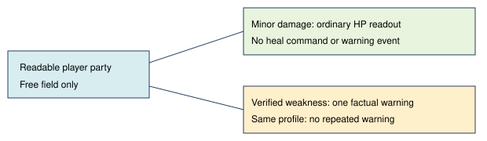

# Coherent healing feedback

> Markdown twin of [coherent-healing-feedback-v1.html](../coherent-healing-feedback-v1.html), generated from the HTML by `just explainer-twins`. The HTML is the source; edit it, not this file.

Default OFF. Bundle ON; control OFF. Implementation candidate; no measured benefit or experiment launch.

## Why change it?

Frontier run ea04 left the gym at 30/33 HP after overlapping heal messages (seq 15000–15002). The same run needed a heal at 14/35 after Josh. HP facts stay visible in both cases.

## One decision about warning delivery

Weakness uses existing criteria: a fainted member, lead below half HP, or verified zero PP for all damaging moves. No new 80% threshold and no prediction that a battle is safe.

## OFF and ON

| OFF | ON |
|---|---|
| Existing independent story, trainer, gym and heal-first messages. | One recorded warning when verified weakness and a relevant battle context exist. Known healing places and applicable BAG items remain options. |

The model still chooses whether to battle, heal or travel. No inputs, destinations or moves are chosen by this switch.

## Grounding and proof

pokeemerald 731ad5bf: src/overworld.c DoWhiteOut, the trainer battle no-running text and existing item descriptions. Production tests use recorded b300 gym state with explicitly labeled ea04 HP variants. Existing warning event types carry the exact delivered text; no timeline additions.

Pending experiment, unqueued and unapproved. Unit/replay correctness cannot establish gameplay speed or reliability.
