# Compact map grid (compact-map-grid-v1)

> Markdown twin of [compact-map-grid-v1.html](../compact-map-grid-v1.html), generated from the HTML by `just explainer-twins`. The HTML is the source; edit it, not this file.

Default off. The switch is a server feature: it changes only how the game server writes the "Current map (observed elements v1)" grid in the observe result. Every tile is still shown, so nothing is lost.

## Why

Bundle run a702 stopped at turn 1303. Its request was 66,676 tokens against a 65,536-token window. The last observe result was 62,809 chars, and 46,558 of them were the map grid for ROUTE 104.

The grid pads every cell to its widest token. Tokens like `g/Eg:g` (tall grass, encounter tile) and `~/Wa:o/Lv:1` are long, so a cell that holds only `#` still takes 12 characters. pret's largest layouts are 80×80 (Routes 124, 126 and 127) and 40×140 (Routes 111 and 119). At that padding, an 80×80 map is about 160,000 chars.

## What changes



*Illustrative cells. Each distinct multi-character token gets one code, listed once. Single-character glyphs (#, ., \~, g, W and the others) stay as they are.*

- Codes are made of letters that are never a single-character glyph on this map and never an element legend key (`S`, `I`, `Wa`, `Eg` and the rest), so a code can't be mistaken for either. One-letter codes are used first, then two-letter, then longer; the supply never runs out.
- Codes are given in reading order: row by row, left to right.
- A `Codes: A = token; …` line follows the title. It reads `Codes: none` when no token needs a code.
- Column numbers are stacked digit lines, read top to bottom. Column 34 is the `3` above the `4`. A view that starts west of column 0 gets a top line of minus signs, so column -6 is the `-` above the `6`.
- Unchanged: gate edges (`|`, `-`), junctions (`*`), the "Base glyph" legend, and every line before and after the grid.

## Recorded example: a702 turn 1300 (ROUTE 104)

Both forms below come from the run's raw RAM (raw-ram/00032220.json.gz), re-rendered through the server's own code with a702's switches. The OFF form matches the recorded grid exactly (46,558 chars). Only the first rows are shown, cut at the right edge for the page; the model receives every row and column.

### OFF

```
Current map (observed elements v1); top-left (0,0), north is up:
               0           1           2           3           4                  5           6           7           8           9                   
   0           #           #           #           #           #                  #           #           #           #           #                   
   1           #           #           #           #           #                  #           #           #           #           #                   
   2           #           #           #           #           #                  #           #           #           #           #                   
   3           #           #           #           #           #                  #           #           #           #           #                   
   4           #           #           #           #           #                  #      g/Eg:g      g/Eg:g           #           #                   
   5           #           #           #           #           #                  #           .      g/Eg:g           #           #                   
   6           #           #      g/Eg:g           .      g/Eg:g             g/Eg:g      g/Eg:g           .      g/Eg:g      g/Eg:g
```

### ON

```
Current map (observed elements v1, compact codes); top-left (0,0), north is up:
Codes: E = ./Wa:puddle; F = g/Eg:g; J = ~/Wa:p/Lv:1; K = ./Br:reflection_below; M = W/Wp:d
                         1 1 1 1 1 1 1 1 1 1 2 2 2 2 2 2 2 2 2 2 3 3 3 3 3 3 3 3 3 3
     0 1 2 3 4 5 6 7 8 9 0 1 2 3 4 5 6 7 8 9 0 1 2 3 4 5 6 7 8 9 0 1 2 3 4 5 6 7 8 9
   0 # # # # # # # # # # . . . . . . . . . . . . . . . . . . . . . . . . # # # # # #
   1 # # # # # # # # # # # # . . . . . . . . . . . . . . . . . . . . . . # # # # # #
   2 # # # # # # # # # # # # . . . . . . . . . . . . . . . . E E . . # # # # # # # #
   3 # # # # # # # # # # # # # # . . . . . . . . . . . . . . E E E . # # # # # # # #
   4 # # # # # # F F # # # # # # . . . . . . . . . . . . . . . E E . # # # # # # # #
   5 # # # # # # . F # # # # # # . . . . E E . . . # . . . . . . . . # # # # # # # #
```

| Qwen3.6 tokens (/tokenize) | OFF | ON |
|---|---|---|
| Map grid | 46,558 chars, 12,180 tokens | 7,283 chars, 3,871 tokens |
| Whole observe result | 62,809 chars, 17,601 tokens | 23,534 chars, 9,292 tokens |

At turn 1300 that saves 8,309 tokens per observe result. a702's failing request was 1,140 tokens over the window.

## Lossless proof

`env/tests/env/test_compact_map_grid.py` builds a random map with water, levels, encounter tiles, bridges, switches, arrows and rotating gates. It does this at each of the 197 distinct layout sizes in pret 731ad5bfd `data/layouts/layouts.json`, which include 80×80 and 40×140. It then reads both forms back into the same cells, gate edges, junctions and trailing text. On maps of 400 tiles or more, the ON form must be under 60% of the OFF length. At 80×80 it goes from 161,825 to 28,243 chars. A second test covers views whose origin is negative (local windows near a map's west or north edge), and a third checks that codes never repeat a glyph or a legend key and keep growing: with one more token than there are one- and two-letter codes, the last code has three letters.

A wiring test renders a full server readout with the switch off and on. The text before the grid and from "Base glyph" on is byte-identical, and the grid decodes to the same tiles.

## Wiring



*Only the highlighted box changes behavior. The switch needs map-observability-v1, because without it there is no observed-elements grid to recode.*

## Status

- Not landed on main, so not in any run yet.
- Focused tests pass: 210 compact Python tests and the TS registry tests. Review round 1 found the negative-origin header bug, now fixed.
- Activation is committed on the branch: `experiments/feature-configs/current.json` lists the switch in the bundle arm's `switches` (ON) and sets it false in the shared base (control OFF), per Operator 2026-10-28 ("they all need to be on in the bundle"). It takes effect only after landing and a new launch.
- Review and gates: three-lane review in progress; full gate on the frozen head under the relayed CPU grant. No measured runs yet.
