Harness switch · connection-edge-tiles-v1 · bundle · default OFF

# Map exits name their tiles

> Markdown twin of [connection-edge-tiles-v1.html](../connection-edge-tiles-v1.html), generated from the HTML by `just explainer-twins`. The HTML is the source; edit it, not this file.

A map connection used to say only "walk across the matching edge". With this switch on, each walking connection lists the exact edge tiles you can walk off, read from the game's live map, and the button that crosses. The loop supervisor and stall briefing repeat them, and a `navigate_to` refusal whose nearest reachable tile is one of them says where it leads.

## What went wrong

Showcase bundle run `2026-10-16T00-34-26_qwen36-gpu1_show`, turns 175 to 188 (events seq 3580 to 3745). Right after the twin asked for help, the model stood at (10,2), one row below Littleroot's north exit. It misread the ASCII map's columns, whose labels start at x=3, and aimed `navigate_to` at wall tiles. Nine refusals said the nearest reachable tile was (10,0), and it never tried it. At turn 189 it walked back to Birch's lab, then crossed at turn 212 with RIGHT, UP, UP, UP. About 37 turns were lost.

Recorded tiles from the run's live map. Grey is solid, sand is walkable. Red dashed: the targets the model tried, (9,1), (8,1), (7,1), (8,0) and (9,0). Green: the two edge tiles this switch lists, (10,0) and (11,0). T is the twin on (10,1), so the open path is (11,2) → (11,1) → (11,0) → UP.

## Before and after

OFF

### Readout

`- NORTH -> ROUTE101 (map 0/16), offset 0; boundary continuation: walk across the matching edge in this direction`

### Refusal

`(8,0) is a wall or other solid tile, not a walkable tile; the nearest walkable tile navigate_to can reach is (10,0)`

### Supervisor

No line about exits.

ON

### Readout

`- NORTH -> ROUTE101 (map 0/16), offset 0; walk off the map from (10,0) or (11,0): stand on one of these edge tiles and press UP`

### Refusal

`… the nearest walkable tile navigate_to can reach is (10,0), an edge tile of this map: stand on (10,0) and press UP to walk off the map NORTH to ROUTE101 (map 0/16)`

### Supervisor

`- Ways off this map across its edge (the game's map connections): NORTH -> ROUTE101 (map 0/16): stand on (10,0) or (11,0) and press UP`

The ON readout line was read from a live game server on the real ROM, loaded at the twin in Littleroot; the OFF line is from the same state with the switch off. The refusal and supervisor lines are from tests replaying the run's recorded state.

## Which edge tiles count

| Check | Game source (pret/pokeemerald) |
|---|---|
| The tile lies inside the connected map's span: `0 ≤ x − offset < destination width` (height for east and west) | `IsPosInConnectingMap`; destination size read from `gMapGroups` → MapHeader → MapLayout |
| The edge tile and the tile one step out both have collision 0 and are not `MAPGRID_UNDEFINED` | The backup map's border holds the connected map's blocks (`FillNorthConnection` and friends); `GetCollisionAtCoords` |
| Neither tile is surfable water | Water needs SURF, so it is not a walk |
| No edge wall on the side being crossed, and no height mismatch | `GetCollisionAtCoords` elevation rule (0 and 15 match any height) |

People standing on an edge tile are not checked; the readout's live objects already list them. A run of three or more adjacent tiles is written "any tile from (a) to (b)". An edge with none says "no tile on this edge can be walked across". Dive and emerge connections are unchanged.

## Wiring

Orange boxes change behavior. The supervisor and the refusal read the edges the server sent in `state.topology`; with the switch off the server sends none and every text is unchanged.

## Status

- **Checks**: Unit tests (Python and TypeScript), OFF byte-equal to the recorded readout, refusal and supervisor text; real-ROM probe on the twin save; delete-the-wiring check
- **Not done**: No measured runs. The experiment entry is pending, not queued.
