# Exact context count

> Markdown twin of [context-exact-count-v1.html](../context-exact-count-v1.html), generated from the HTML by `just explainer-twins`. The HTML is the source; edit it, not this file.

`context-exact-count-v1`, a guard. Default off; on in both arms of the current recipe.

## What it fixes

On 2026-10-27 the HyperQwen 3h control run `2026-10-27T15-23-07_hyperqwen-gpu0_e1f1` ended at turn 178 (4:38 PM New York time) with `model_error`. The estimate in `context-token-budget-v1` trimmed the request to a predicted 58,371 prompt tokens. vLLM counted 61,441. With 4,096 reply tokens that is 65,537, one over the 65,536 context, so vLLM answered 400. The estimate did not read vLLM's error wording, so the same request was sent three times and the run ended.

**72** tokens per 240×160 game frame on Qwen3.8 (vLLM)

**1,000** tokens per image in the estimate

**3,070** tokens the trimmed e1f1 request was under-counted

## Why the estimate missed

The estimate anchors on the server's count for the previous request and adds the change in its own weight. Dropping a turn with a frame subtracts 1,000 from the prediction, but the server saves only 72. Each dropped frame leaves the prediction about 928 tokens too low.



## What ON does



- Only whole turns are dropped: an assistant reply with its tool results and frames. The system prompt, the task message and the newest turn always stay. No text inside a message is cut.
- vLLM: the limit is `max_model_len − max_tokens − reserve`, with no estimate margin, because the count is the server's own.
- llama.cpp: text is exact. Each image is charged 1,000 until the server's `prompt_tokens` for a counted request gives the real per-image count.
- If `/tokenize` fails, that one request is trimmed by a high estimate (characters ÷ 3, 1,000 per image, 2,048 margin) and recorded as `source: "estimate"`.
- Gateway and LM Studio lanes keep the `context-token-budget-v1` estimate; with this switch on it also reads vLLM's context-length error.
- The model sees nothing new. Only which old turns are in the request changes.
- A run is refused at launch if `just-in-time-prompt-v2` is also on: that switch attaches its guide to a history turn, which the fit could drop. The current recipe has it off in both arms.

## What is recorded

On a vLLM or llama.cpp lane, each turn's `assistant` event carries `prompt_count` beside the server's `usage`. Gateway and LM Studio lanes, which keep the estimate, carry none; their trims are still `compaction` events. From the live check below (a 16-token reply, so the limit is 65,536 − 16):

```
"usage": {"input": 5373, "output": 16, "cache_read": 0},
"prompt_count": {"tokens": 5373, "source": "vllm-tokenize",
                 "limit": 65520, "reserve": 0, "dropped_turns": 0}
```

Each trim is also a `compaction` event with the exact before and after counts. Request bodies are not saved. Nothing is added to the timeline.

## Live check (2026-10-27, GPU0 vLLM 0.31.0, Qwen3.8-27B)

| Request | /tokenize count | vLLM prompt_tokens |
|---|---|---|
| e1f1 system prompt, tools, 6 frames, 6 turns | 5,373 | 5,373 |
| same, forced to drop 5 turns | 4,678 | 4,678 |

A `/tokenize` call took 5–25 ms.

## Off

`context-token-budget-v1`'s estimate alone, reading only llama.cpp's context-length error, exactly as before.
