# Context token budget

> Markdown twin of [context-token-budget-v1.html](../context-token-budget-v1.html), generated from the HTML by `just explainer-twins`. The HTML is the source; edit it, not this file.

`context-token-budget-v1` · guard · default off

The model server holds 65,536 tokens. The harness keeps the last 11–20 turns. When the model gets stuck and writes long, repetitive replies, those 20 turns can grow past what the server holds, and the run ends on a model error. This switch drops the oldest whole turns just before a request would not fit.

## What filled the request that failed

*Bundle run `2026-10-19T23-16-14_qwen36-gpu0_7346`, turn 771: 67,511 tokens requested. The grey block is the system prompt and instruction ledger (\~7k). Sizes come from recorded character counts; the screenshot share is the gap between the character estimate and the server's count.*

## What the switch does before each model call

*Off sends the window as it is. On removes whole turns from the oldest end, and only when the prediction is over the budget.*

## How it predicts the request size

| Piece | Value |
|---|---|
| Budget | served context − max tokens − 2,048 (65,536 − 4,096 − 2,048 = 59,392) |
| Anchor | the prompt tokens the server reported for the previous request (input + cache read + cache write), or the request size in a `request (N tokens) exceeds the available context size` error |
| Change since the anchor | characters ÷ 3 + 1,000 per image, for what was added or removed |
| Prediction | anchor + change; before any anchor, the estimate alone |

The weights are deliberately high: this harness's text tokenizes at about 3.1 characters a token. If a prediction is still too low and the server answers with an overflow error, that error becomes the anchor and the retry is trimmed to fit. The run's failure limit counts the error as one model error; the next good reply resets it.

## Where it shows up

- Each trim is recorded as a `compaction` event (predicted tokens before → after), shown in Activity History and the COMPACTIONS count.
- The next `turn_start` records the smaller message and image counts.

## Off

The turn and result window is the only bound. A request over the served context fails as a model error, and three in a row end the run.

## Status

Operator decision 2026-10-20: on in both arms of the six-hour bundle-versus-control cook pair, together with `tutorial-party-owner-v1`. Registered as a pending one-switch experiment; not measured on its own.
