Harness switch · counter-talk-v1

# You can talk across a counter

> Markdown twin of [counter-talk-v1.html](../counter-talk-v1.html), generated from the HTML by `just explainer-twins`. The HTML is the source; edit it, not this file.

The tile in front of a Pokémon Center nurse is a counter. It blocks walking, so the map drew it as `#` and the nurse looked walled in. The game lets you talk to whoever stands behind a counter you face. With this switch on, the map draws that tile as `=` and says so, and `navigate_to` tells the model where to stand.

## Before and after, in the Oldale Pokémon Center

### OFF The nurse looks unreachable



Every tile around the nurse at (7,2) is `#`. Nothing in the text says the wall in front of her is special.

### ON The counter is `=`, and A works across it



Recorded route: from (8,7), `navigate_to` (7,4) took UP, UP, UP, LEFT. Then UP to face the counter and A opened the nurse's greeting. Walking onto (7,3) is still refused (red).

Only (7,3) is a counter tile (behavior `0x80`). The rest of the desk row has other behaviors, so it stays `#`. That matches the game: only the tile straight in front of the nurse lets you talk across.

## What the model reads

```
       1   2   3   4   5   6   7   8   9  10  11  12  13
   2   .   .   .   #   #   #   N   #   #   .   .   .   .
   3   .   .   .   #   #   #   =   #   #   .   .   .   .
   4   .   .   .   N   .   .   .   .   .   .   .   .   .
```

```
@ player; N live object; W warp location (see activation below); # collision; g grass; ~ water;
 = counter: you cannot walk onto it, but you can talk to someone standing behind it by facing the counter and pressing A;
 v ^ < > ledge: ... ; . clear terrain (may have script triggers); ? outside current map.
```

Copied from the recorded run. The counter clause appears only when a `=` is actually drawn in view: a counter under a person, or a counter tile with no collision, adds nothing. Off: the row reads `# # # N # #` / `# # # # # #` and the clause is gone.

## Where navigate_to tells you to stand



A stand tile is named only if it is a known tile that `planNavigation` itself would reach. That excludes walls, water, a person standing there, a different elevation and tiles outside the 15×15 window. A goal with no counter involved keeps the old "no supported path" message. The same check runs on the 15×15 window or, with whole-map navigation on, on the whole current map.

| Goal | Result text (recorded or tested) |
|---|---|
| Nurse (7,2) | `target is behind a counter; walk to (7,4), face UP toward the counter at (7,3) and press A to talk across it` |
| Counter (7,3) | Same text: the person is found on the far side. |
| Stand tile blocked, occupied, unknown or other elevation | `target is a counter or behind one; you cannot stand on a counter, but you can face it from a reachable adjacent tile and press A to talk to someone behind it` |
| Empty counter, nobody behind it | The generic counter text above. |
| Switch off | `no supported local path; choose a reachable local waypoint` |

## Game grounding

| Source (pokeemerald 731ad5b) | What it says |
|---|---|
| `include/constants/metatile_behaviors.h` | `MB_COUNTER` is enum value `0x80`. |
| `src/field_control_avatar.c` `GetInteractedObjectEventScript` | Pressing A looks for a person on the faced tile. If nobody is there and that tile is a counter, it looks one more tile in the same direction and talks to that person. |
| Live map collision bits | Counter tiles carry collision, so they block walking. We draw `=` only for a counter with collision; a counter without collision stays `.`. |

PokeAgent's vendored server does not special-case counters; this is our own live-map code. The vendor tree is untouched.

## Wiring



Guidance group, needs `live-map-v1`. Older presets that do not name the switch read it as OFF, so frozen incumbents still see `#`. Viewer drafts start with every switch ON. The planner is unchanged: counters were never walkable.

## Status

- **Checks**: Passing: vitest (agent and viewer), pytest, coverage floor 90 on both stacks, tsc/eslint/ruff/mypy, vendor pin.
- **Live proof**: Recorded run on the real ROM from `torchic.state`: Route 101 → Oldale Town → Pokémon Center 1F. Event log shows the hint with 0 button presses, then the route and the nurse's greeting. The latest probe ran with whole-map navigation on: the whole-map readout row 3 reads `....###=##....`.
- **Review**: Round 1: Claude and Grok LGTM; Codex blocked on four points, all fixed. Round 2: Claude, Codex and Grok LGTM. Round 3 (after the whole-map merge): Claude, Codex and Grok LGTM.
- **Viewer**: The PokeNav configuration card links here (READ EXPLAINER).
- **Not done**: No measured runs. Experiment readiness: BLOCKED until models reliably reach Oldale Town (0 of 124 recorded model runs had, as of 2026-10-14). See `docs/experiments/readiness.md`.
