Harness switch · cross-map-goal-v1 · default OFF · bundle arm only

# A goal on another map is not a map change

> Markdown twin of [cross-map-goal-v1.html](../cross-map-goal-v1.html), generated from the HTML by `just explainer-twins`. The HTML is the source; edit it, not this file.

`navigate_to` takes a `map_id` with every target. When the model passes a map it is not standing on, the tool used to answer `map changed; inspect destination` with 0 presses. Nothing moved and no map changed, so the model retried the same call. With this switch on, the tool presses nothing and says the target is on another map. It is meant for the bundle arm only (operator decision, 2:53 PM New York time, 2026-10-16).

## What went wrong in recorded runs

| Run | Call | Where the player was | What it was told (OFF) |
|---|---|---|---|
| `4caa` seq 12480, 12503, 12526, 12549 | `navigate_to(8,0, map_id [0,9])` (12480: (0,6)) | ROUTE101, map 0/16, at (10,19) | `Navigation: map changed; inspect destination; 0 ordinary button attempts.` |
| `4caa` seq 14588, 14597, 14607 | `navigate_to(6,4, map_id [0,10])` | ROUTE101, map 0/16, at (11,0) |  |
| `8b01`, 17 results | 12 calls with `map_id [0,18]` (seqs 10180–10558): 11 to `(9,8)`, one to (9,0); the longest unbroken run is six | map 0/10 |  |

Every one of these says 0 ordinary button attempts. A loop-guard "ineffective" warning followed at 4caa seq 12550 and 14608. Results where the map really changed during a walk (4caa seq 981, 1326) all have presses, and keep their wording.

## Where the check sits in the walk loop

Only the highlighted boxes are new. OFF goes straight from "no" to `map changed`, as before. After a press, a different map is a real change, ON or OFF. If the current map is unknown (`map_id` null), ON skips to the readiness check, which already says why it cannot walk.

## Before and after, recorded 4caa seq 12549

OFF

`Navigation: map changed; inspect destination; 0 ordinary button attempts.`

What the model received. False: the player stayed on ROUTE101 at (10,19).

ON

`Navigation: (8,0) on map 0/9 is on another map; you are on map 0/16 (ROUTE101) and navigate_to only walks within the current map; to walk on this map, pass map_id [0,16]; to reach map 0/9, use a listed warp or a map connection; 0 ordinary button attempts.`

Same recorded state, replayed in `cross-map-goal.test.ts`. No button is pressed.

## Data and interface

| Field | Source | Meaning |
|---|---|---|
| `goal.map_id` | tool argument, `[group, number]` | The map the model says the target is on. |
| `state.map_id` | game state (gSaveBlock1Ptr-&gt;location mapGroup, mapNum) | The map the player is on. |
| `location_display` or `location` | game state | The place name the readout shows, in parentheses when known. |

Nothing is truncated. The tool description and parameters do not change.

## Wiring

Run preset or switchboard `cross-map-goal-v1` → `FeatureSet` → `withNavigation` → `NavigationPorts.crossMapGoal` → walk loop in `navigationTool`. Needs `bounded-navigation-v1` (no tool without it).

## Status

Unit tests replay the recorded 4caa case (OFF bytes equal what the model received; ON true reason, no press), real map changes after a press at both checks, the unknown-map fallback, and production wiring. Not done: measured runs. Default OFF; the bundle arm turns it on.
