# One name for the current map

> Markdown twin of [current-map-display-name-v1.html](../current-map-display-name-v1.html), generated from the HTML by `just explainer-twins`. The HTML is the source; edit it, not this file.

Switch `current-map-display-name-v1` (frontier report H7). Default off; on in the bundle arm only. It needs `semantic-current-map-feedback-v1`. No measured runs yet, so no claim that it helps.

## What it fixes

When the model asks `navigate_to_target` for a target on a map it is not on, the tool refuses, sends no input, and says where the player is. That "Current map:" line used the name from the game's map table, while the header, the Location line and the exits list name the same map by the name the game shows. The OBSERVED INSTRUCTION MEMORY block also printed map-table names. With the switch on, both use the shown name.

In run 47c3 at seq 4776 the player stood on map 1/3. One tool result carried both names:

```
Exits you can walk to from where you stand: (1,1) … -> PROF. BIRCH'S HOUSE 1F (map 1/2) …
Current map: LITTLEROOT TOWN MAYS HOUSE 2F (map 1/3). Position: (1,2). No input was sent.
```

The model wrote: "This means the game uses map 1/3 for BOTH Prof. Birch's 2F and May's 2F!"

## One map, two names



*Values from the recorded state at 47c3 seq 4775 (fixture `test-support/current-map-display-47c3.json`). Off, the Current map line was the only line in that result reading the map-table name (dashed red). On, it reads the same name as everything else (green).*

## The line, off and on

| Case | Current map line |
|---|---|
| OFF (recorded at 47c3 seq 4776) | `Current map: LITTLEROOT TOWN MAYS HOUSE 2F (map 1/3). Position: (1,2). No input was sent.` |
| ON, same state | `Current map: PROF. BIRCH'S HOUSE 2F (map 1/3). Position: (1,2). No input was sent.` |
| ON, state without a shown name | the map-table name, as OFF |
| Memory block map column, ON | each page's recorded `map_display`; the map-table name when a page has none |
| ON, state with neither name | `Current map: name unavailable (map 1/3). …` |

Map ids, positions, the refusal itself and every other line are unchanged. The shown name is the state's `location_display`, from `displayed-place-names-v1`.

**Off:** the map-table name (LITTLEROOT TOWN MAYS HOUSE 2F) in both places, the Current map line and the memory block, as today.

## The memory block, off and on

The model's thought quoted above first appears in turn 160, before this call's result at seq 4776, and recurs in later turns through at least turn 175. In it the model says it saw the table name in "the historical dialogue". That is the OBSERVED INSTRUCTION MEMORY block (`observed-instructions-v1`), which lists each page's map. At seq 4777 its map column printed "LITTLEROOT TOWN MAYS HOUSE 2F" 5 times, so the switch now covers this block too.

Each page in that block is `[speaker, speaker_source, text, map, map_id, state_event]`. Recorded at 47c3 seq 4777 (OFF), the PC's pages from turn 66:

```
["PC","faced_target","There's an e-mail from POKéMON TRAINER\nSCHOOL.","LITTLEROOT TOWN MAYS HOUSE 2F",[1,3],1352]
["PC","faced_target","… … … … … …","LITTLEROOT TOWN MAYS HOUSE 2F",[1,3],1358]
["PC","faced_target","A POKéMON may learn up to four moves.","LITTLEROOT TOWN MAYS HOUSE 2F",[1,3],1364]
```

ON, the same pages name the map by the `map_display` recorded with each page (47c3 recorded it):

```
["PC","faced_target","There's an e-mail from POKéMON TRAINER\nSCHOOL.","PROF. BIRCH'S HOUSE 2F",[1,3],1352]
["PC","faced_target","… … … … … …","PROF. BIRCH'S HOUSE 2F",[1,3],1358]
["PC","faced_target","A POKéMON may learn up to four moves.","PROF. BIRCH'S HOUSE 2F",[1,3],1364]
```

The ON rows are built from the recorded pages by the switch's rule; the test `current-map-display-name.test.ts` checks it on a page from map 1/3 (ON: "PROF. BIRCH'S HOUSE 2F" and no "MAYS HOUSE"). The same rule renames the other maps in that block as the readout showed them, for example LITTLEROOT TOWN BRENDANS HOUSE 2F becomes RED's HOUSE 2F in this run. A page recorded without `map_display` keeps the map-table name. Map ids and the other columns are unchanged.

## Wiring


*The highlighted choice in `semantic-navigation.ts` is one of the two behavior changes. The other is the same choice for each page's map in `observed-instructions.ts` (the OBSERVED INSTRUCTION MEMORY block).*

## Status

- Tests: `packages/agent/src/current-map-display-name.test.ts` (OFF reproduces the recorded 47c3 line, ON uses the shown name, both fallbacks, the memory block off and on, registry and presets).
- Default off; on in the bundle arm (`switches`) only. No measured runs yet, so no claim that it helps.
- Multi-model review and landing are pending.
