# Current run on the story frontier

> Markdown twin of [current-run-frontier.html](../current-run-frontier.html), generated from the HTML by `just explainer-twins`. The HTML is the source; edit it, not this file.

The human baseline and agent record stay visible. A healthy current run is an additional anchor, even when the selected filters exclude it. Its last confirmed checkpoint glows and pulses in its model color.

*The highlight follows verified status, not merely an unfinished log.*

Only recorded story checkpoints are plotted. A run with no confirmed checkpoint has a live label while waiting. Optional gym-trainer battles are absent from the story frontier; original recording evidence is preserved.

State refresh uses the existing five-second polling loop. No game inputs, model requests or benchmark source edits are needed. The frontier was landed after visual approval and independent review. The compact current-run bar and Watch navigation follow-up are on the isolated branch for visual review.

## Opening the live viewer

*Clock ticks update text fields without replacing the link. Historical validation is requested separately from watching.*

The current run spans the available width. Time, progress, objective and Watch sit in a compact row on desktop, with a wrapping layout on narrow screens. The same recorded evidence and comparison validation remain in use.

All open comparison tabs share one in-flight snapshot and the completed result for the five-second polling interval. This bounds repeated full-log validation while the viewer routes remain available between refreshes. Failed refreshes are cleared so the next request can recover.
