# Cut-off reply feedback

> Markdown twin of [cut-off-reply-feedback-v1.html](../cut-off-reply-feedback-v1.html), generated from the HTML by `just explainer-twins`. The HTML is the source; edit it, not this file.

`cut-off-reply-feedback-v1` · guard · registry default OFF · enabled in both arms of current recipes

When a reply stops at the max_tokens limit before it makes any tool call, the next message tells the model so, instead of the plain "Keep playing" nudge.

## What went wrong

Four GLM-5.3-Flash runs had 11 replies stop at the limit with no tool call, about 31 minutes in all. In `2026-10-21T05-17-26_glm53-mac_ad34` three came in a row (seq 13818, 14408, 14998), each spent hand-counting cells of the ASCII map. The next request only said "Keep playing: call observe or press…", so the model never learned that its reply was cut off, and began the same count again.

*Before and after. The reply is illustrative (the shape the tests use); both messages are the exact strings `cut-off-reply.test.ts` asserts for a run with both walking tools and 4096 max tokens.*

## The notice text

The number is the run's own max tokens: the play preset's `sampling.maxTokens`, or else the smaller of 4096 (`PLAY_MAX_TOKENS`) and the model's limit. The walking sentence names only the walking tools the run offers.

| Walking tools offered | Second part of the notice |
|---|---|
| navigate_to_target and navigate_to | "To walk somewhere, call navigate_to_target or navigate_to: they work out the path from the game's map, so the route does not have to be worked out in your reply." |
| navigate_to only | "To walk somewhere, call navigate_to: it works out the path from the game's map, so the route does not have to be worked out in your reply." |
| Neither | None. The notice ends at "Make one tool call now." |

The first part is always: "Your last reply reached the output limit (N tokens) before it made a tool call, so nothing happened in the game. Make one tool call now." Nothing sent to the model is clipped.

## Keep the cut-off cause in every recovery

*Precedence in `Governor.nudge()`. The test drives three cut-off replies in a row with failure limit 3: all three name the cap; the third also gets the supervisor briefing.*

- With the switch ON, fixed-point recovery also names the configured cap after a cut-off; its recorded text matches the delivered message. With it OFF, both supervisors retain their previous text.
- The failure count is unchanged: a cut-off reply still counts as "reply hit max_tokens" toward the failure limit.
- A cut-off reply that did make a tool call gets no follow-up message, as before.
- Decision probes rebuild the same follow-up with `followUpText`: a recorded supervisor note after the reply first, then the notice for a `"length"` reply, else NUDGE. Recorded reconstruction retains historical note text. Replayed probes bind each supervisor to its assistant turn, remove only the exact recorded cut-off prefix, and rebuild the notice from the probed switches and recorded token cap.

## Status

- Original implementation: f2f79d77. Current repair: a working branch; tests and review tracked in its worklog. No new gameplay runs authorized.
- Operator-authorized 2026-10-24: cut-off feedback enabled in both arms of current recipes. GLM 1h/2h/4h definitions use 4,096 tokens in control and an optional bundleMaxTokens of 8,192 in bundle. Other model caps are unchanged.
- Tests: `cut-off-reply.test.ts`, `decision-probe-live.test.ts` (a scripted reply that stops at max_tokens goes through live.ts; the next request carries the notice ON and NUDGE OFF). Original implementation had cloud review; current repair review is tracked separately in its worklog.
- The larger cap has not been measured. A short reply can still finish before either cap. A long reply can now spend more time generating before its next tool call.
