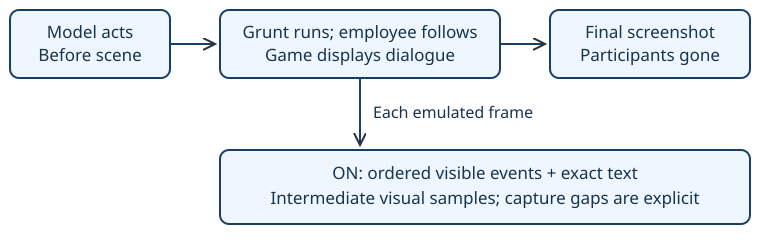

# Cutscene journal

> Markdown twin of [cutscene-journal-v1.html](../cutscene-journal-v1.html), generated from the HTML by `just explainer-twins`. The HTML is the source; edit it, not this file.

Preserve what happened between the model’s game observations.

## The missing chase

In Astra’s Rustboro scene, turn 415, result 13938 contained all three dialogue pages and one screenshot after both participants had left. Internal state 13923 contained the Aqua sprite. The model received no movement history.



## One general mechanism

A frame hook reads visible field actors and displayed field text under the emulator’s existing memory lock. Map-local object IDs distinguish people with the same sprite. Rendered sprite coordinates account for camera position; invisible and offscreen objects are excluded.

| Switch OFF | Switch ON |
|---|---|
| Existing observation and dialogue behavior. | Adds chronological scene history to the next game-tool result. |
| No scene hook or endpoint. | Actor appearances, tile movement, departures, displayed text and visual samples. |
| Existing current screenshot. | Current screenshot remains first; historical samples are labeled separately. |

## Evidence, not a walkthrough

A sprite kind is a graphic description, not a person’s name. The journal does not assign an unnamed speaker, infer a destination after someone leaves view, or tell the model what to do. Existing dialogue attribution remains available in the ordinary dialogue list.

```
Illustrative format; positions come from observed frames:
[scene event 6, native step 3] map (0, 3): object 10 (sprite AQUA_MEMBER_M) appeared at (20,21)
[scene event 10, native step 5] map (0, 3): field text (speaker not established): "Don't take my GOODS!"
[scene event 11, native step 6] map (0, 3): object 9 (sprite MAN_2) moved (20,21) -> (20,18)
```

The example is a sparse reparse of the original recording. Native steps here count supplied samples; it is not a reconstruction of every original frame.

## Bounds and known limits

- The journal retains 512 events. Missing event IDs and failed coherent frame reads are reported.
- Visual samples occur on scene entry and every 120 emulated frames during locked field scenes and supported cinematic or unknown callbacks. They are samples, not continuous video.
- At most six historical images are delivered per result. Additional samples are counted as omitted.
- Object movement is observed tile change. Special effects and cinematic graphics are conveyed through visual samples; complete coverage of every game cinematic is not claimed.
- The hook reads evidence only. It changes no button inputs, dialogue advancement, routes or decisions.

## Bundle and evaluation

`cutscene-journal-v1` defaults OFF. The current feature recipe enables it in the bundle and leaves control OFF, as requested. Existing runs remain on their recorded code. The later ablation must determine whether this improves model behavior.

<details>
<summary>Source and verification</summary>

Game source: pret/pokeemerald 731ad5bfd6e6f265508d0efcca0ba42f9dcf5881. Structs ObjectEvent and Sprite; sprite.c UpdateSprites; RustboroCity_EventScript_StolenGoodsScene and Movement_GruntEscape. Addresses reuse the US-ROM readers for object events, sprites, field controls and text printer.

Regression scope: transient actors, silent movement, map changes, same-sprite identities, displayed text bounds, cursor loss and recovery, HTTP/factory delivery, exact OFF path and current recipe materialization. Original recordings remain unchanged. Review and landing evidence belongs in the worklog.

</details>
